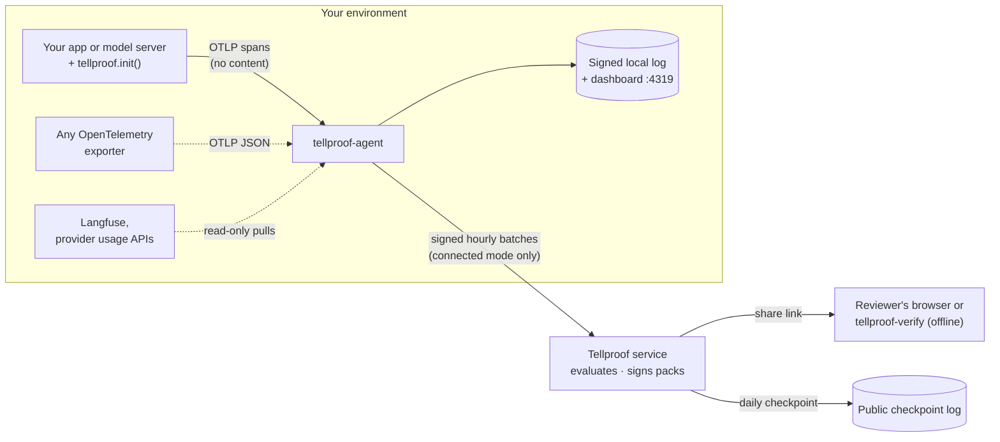

# How Tellproof works

This is the technical companion to the [README](README.md), which covers installing, setting up and using Tellproof. This document explains what happens under the hood: the parts and how data moves between them, what is recorded and what never is, how evidence is signed, chained and verified, and what it can and cannot prove.

## Contents

1. [Why Tellproof](#why-tellproof)
2. [Who it is for](#who-it-is-for)
3. [The parts](#the-parts)
4. [Local or hosted](#local-or-hosted)
5. [From a model call to a signed batch](#from-a-model-call-to-a-signed-batch)
6. [What leaves your machine](#what-leaves-your-machine)
7. [The data directory](#the-data-directory)
8. [The eleven evidence objectives](#the-eleven-evidence-objectives)
9. [Evidence that can fail: canaries and the self-test](#evidence-that-can-fail-canaries-and-the-self-test)
10. [Evidence for coding agents](#evidence-for-coding-agents)
11. [Signed evidence packs: the hosted service](#signed-evidence-packs-the-hosted-service)
12. [Verification](#verification)
13. [Security model](#security-model)
14. [Wire formats and names](#wire-formats-and-names)

---

## Why Tellproof

| | |
| --- | --- |
| 🔌 **One line, any stack** | `tellproof.init()` instruments the OpenAI, Anthropic and Bedrock clients you already use, in Python or Node.js, with no dependencies. Model vendors wrap their serving layer with one helper. OpenTelemetry works too. |
| 🔏 **Tamper-evident by design** | Every hour is a signed, chained batch with a Merkle commitment to its traces. Edit, drop or reorder one and verification fails, in the CLI, the dashboard and the browser verifier alike. |
| 📊 **A dashboard, locally** | Calls and tokens per model and region, guardrail coverage, personal-data redaction, agent tool use, changes and anomalies, served by the agent on loopback. No account, no SaaS. |
| 📐 **Governance as code** | Declare models, regions and registers in `tellproof.policy.json`. `check` evaluates the eleven evidence objectives and fails CI when one fails, with a GitHub Action, and `aibom` writes a CycloneDX AI bill of materials from the evidence. |
| 🧪 **Evidence that can fail** | A check that cannot fail proves nothing. Guardrail canaries send known-bad probes through your own guardrail and record whether it caught them; `check --self-test` proves every objective fails on bad evidence and every tampering is caught. |
| ✅ **Verifiable by anyone** | Packs are DSSE-signed in-toto statements. Three independent verifiers (Go, browser, Python) agree on every published test vector, and the evaluator itself is open source. |

## Who it is for

### You build an AI-powered app or agent

You call OpenAI, Anthropic, Amazon Bedrock or any OpenAI-compatible API, and your customers' security, risk and procurement teams keep asking the same questions.

| You need to show | What Tellproof records |
| --- | --- |
| **Which models and providers you use, and where they run** (vendor-risk questionnaires, data-residency clauses) | Calls and tokens per provider, model and region, every hour. Packs check them against the models and regions you declared. |
| **That guardrails run on every call** | For each model call, whether a guardrail decided on it (allow, block or flag), and how many were blocked. |
| **That personal data is removed before it reaches a model** | How many spans carried personal data, and how many of those were redacted first. |
| **That no prompt or completion text is kept** | Spans that arrive carrying message content are counted and the content dropped; the count is the evidence. |
| **What changed, and when** | Every model change and prompt-version change, with its time: a material-change log for your AI system. |
| **That evaluations are current** | Evaluation runs (suite, model, prompt version, pass rate, time), set against the models and prompt versions that were actually live. |
| **That an agent's actions are under control** | Agent runs, tool calls and tool errors, high-impact tool calls and how many were approved, hand-offs to a person. |
| **That nothing was left out** | A Merkle commitment to every trace in every hour, and token totals that can be reconciled with the provider's own billed usage. |
| **That the system is what you said it is** | A policy file in your repository declares the models and regions it may use and keeps the change, incident and evaluation registers; `check` evaluates the evidence against the eleven evidence objectives and fails CI when one fails. |
| **An inventory of the AI you actually run** | `aibom` writes a CycloneDX 1.6 AI bill of materials of every model declared or seen, with regions, volumes and first and last use. |
| **Operational awareness, privately** | A local dashboard of all of the above, hour by hour, without sending anything to a SaaS. |

### You are an AI model vendor or inference provider

You serve your own models (or host others') behind an API. Wrap each inference request in your serving layer with one helper, and you can show your customers which models and regions served their traffic, guardrail and redaction coverage on your side, and model changes over time. They can pass that evidence on to their own reviewers. See [For model vendors and inference providers](README.md#for-model-vendors-and-inference-providers).

### You ship code written with coding agents

Claude Code, Copilot, Cursor and their peers now write a large share of commits, and reviewers want to know the same thing about all of it: did the checks actually run, and could they have caught a mistake? See [Evidence for coding agents](#evidence-for-coding-agents).

### You review AI vendors: bank, insurer, auditor, risk or procurement team

A vendor sends you a share link or a pack file. You check it yourself, in your browser or with an offline command, against the issuer's published keys: no account, no trust in the vendor, no trust in Tellproof. Three independent verifiers (Go, browser, Python) must agree on every [published test vector](spec/vectors/README.md), and you can write a fourth. See [Verification](#verification).

### You run security, platform or GRC for an AI product

- Audit exactly what the agent would send before you allow it: `tellproof-agent run --dry-run` prints every batch, decoded, and sends nothing.
- Run it with no network egress at all (local mode).
- Keep governance in code review: `tellproof.policy.json` sits next to the code, `policy validate` checks it in CI, and `check` (or the [GitHub Action](README.md#in-ci)) gates releases on the eleven evidence objectives.
- Map results to framework references by ID (EU AI Act, ISO/IEC 42001, AIUC-1, CSA AICM and more; each objective lists the references it supports), hand auditors an AI-BOM, and, with the hosted service, keep your compliance platform (Vanta) up to date automatically.

---

## The parts



| Part | What it does |
| --- | --- |
| **SDKs** (`tellproof` for Python and Node.js) | `tellproof.init()` instruments the OpenAI, Anthropic and Bedrock client libraries you already use: one span per model call with provider, model, region, token counts, operation, timing and error status. **They never read message content.** Each web request is its own scope. The facts no client library knows come from `init()` (agent, prompt version, personal data), from the app's own guardrail and redaction functions marked once (`@guardrail_check`, `@redactor`: only that they ran and the decision), from guardrails the SDK can see (OpenAI moderation, Bedrock Guardrails, Azure OpenAI content filters), or from explicit scopes. Spans go as OTLP JSON to the agent through a bounded background queue that drops (and counts) rather than slow the app. |
| **Agent** (`tellproof-agent`) | Runs next to your app. Receives spans on `127.0.0.1:4318`, drops every message attribute at parse time, aggregates per hour, commits every trace into a salted Merkle tree, and signs each hourly batch with its own Ed25519 key. One static Go binary, standard library only. |
| **Local mode** | The agent keeps the signed, chained batches in its data directory and serves a dashboard. Nothing is sent anywhere. |
| **Connected mode** | The agent sends the same signed batches to the Tellproof service, which evaluates eleven evidence objectives and issues signed, chained monthly packs. |
| **Verifiers** | `tellproof-verify` (offline command), the verify page (in the browser) and `concierge/verify.py` (an independent Python verifier). |

The SDK packages also install a `tellproof` command when the agent comes with them (`pip install "tellproof[agent]"`, `npm install tellproof`). It is a few lines that run the installed agent binary with the same arguments; the SDK itself never imports it, so the app's process never loads the agent.

## Local or hosted

| | Local mode (open source) | Hosted service (early access) |
| --- | :---: | :---: |
| One-line SDKs, agent, content dropped at parse time | ✓ | ✓ |
| Signed, chained hourly batches with trace commitments | ✓ | ✓ |
| Dashboard and terminal report | ✓ | ✓ |
| Policy file, `check` against the eleven objectives, CI gating, AI-BOM | ✓ | ✓ |
| Guardrail canaries and `check --self-test` | ✓ | ✓ |
| CI evidence per commit for coding agents (`ci`), with must-fail canaries | ✓ | ✓ |
| Evidence signed by an **independent issuer** (KMS-held key) | | ✓ |
| Monthly packs, chained, in a **public daily checkpoint** | | ✓ |
| Share links for reviewers, with view counts | | ✓ |
| Registers in an app, Vanta sync | | ✓ |
| Data leaves your environment | **never** | signed counts only |

A local log proves it has not changed since it was written, relative to `agent.pub`, the agent's own key. That is a self-assessment: the evidence is signed by your agent and evaluated by you. A pack is the same evaluation, signed by an independent issuer.

---

## From a model call to a signed batch

**1. The SDK records facts, not content.** Per call it reads the request's model and stream flag, and from the response only the model, the usage block, the stop reason and Bedrock's token-count headers. Input tokens follow what the provider bills (Anthropic: uncached + cache writes + cache reads), so traced tokens can be reconciled with billed usage. Streams are recorded once, when they end. It never reads message arguments, completions, function arguments, return values or exception messages, so there is nothing to filter. Instrumentation errors are swallowed and counted; the SDK can be turned off with `TELLPROOF_DISABLED=1`.

**2. The agent drops content at parse time.** It reads the OpenTelemetry GenAI conventions (old and new names) and a few `tellproof.*` attributes, as listed in [`spec/semconv-map.json`](spec/semconv-map.json). Message attributes are never decoded: their presence is counted (`content_present_spans`, objective EO-CNT-01) and the values dropped. The list (`presence_only`) covers the GenAI and OpenLLMetry names, OpenInference, Traceloop, Langfuse and the Vercel AI SDK; tool definitions, prompt templates and generic fields such as `exception.message` are deliberately not counted as message content, and are never read either.

**3. Copied values must be identifiers.** The few values a batch copies from a span, the provider, model, region and prompt version, must look like identifiers ([`spec/identifiers.json`](spec/identifiers.json)): letters, digits and `._:/@+-`, at most 128 characters, and not shaped like a credential (AWS, OpenAI, Anthropic, GitHub, Slack, Google, GitLab and Stripe key formats, or a JWT). Anything else, such as a prompt written into `gen_ai.request.model` by mistake, is replaced by `invalid` before it is counted; a guardrail canary's kind becomes `other`. The model inventory check then shows `invalid` as an undeclared model, so the mistake is visible rather than silent.

**4. Hourly windows.** Spans are aggregated into hourly windows (UTC). A window closes `grace_minutes` (default 5) after the hour, so late spans still count; spans later than that go into the next window and are counted as late. After a start, the open hour is also sent once, `first_batch_seconds` (default 60) after the first spans, so a new agent shows up at once. Windows are additive, so the rest of that hour follows when it closes.

**5. Trace commitments.** Each trace becomes a leaf `sha256(0x00 ‖ salt ‖ trace_id)`, where the salt is derived from a secret that stays with you. The window's leaves form a Merkle tree whose root goes in the batch. The commitment reveals nothing, yet a single trace can later be disclosed and proved to be in it; the leaves stay in the data directory for that.

**6. Signed and chained.** Each batch is signed with the agent's Ed25519 key, names the previous batch's digest and carries the next sequence number, so a lost, edited or replayed batch is detected. In local mode batches are kept in `<data-dir>/local`; in connected mode they are queued (fsynced before they are acknowledged) and sent to the one server you configure, retried with backoff of up to 15 minutes.

`report`, `check` and the dashboard all read the same verified log: every signature against `agent.pub`, the sequence from 1 without gaps, each batch naming the previous one's digest, nothing missing from the end. A log that fails verification is never evaluated.

---

## What leaves your machine

**In local mode, nothing.** In connected mode, one signed batch per hour, defined by [`spec/batch.schema.json`](spec/batch.schema.json) (`plumbline-batch/v0.2`), or, for an hour with guardrail canaries, [`spec/batch-v0.3.schema.json`](spec/batch-v0.3.schema.json), which adds `"canaries": [{"kind": "pii", "run": 1, "caught": 1}]`: counts per kind, never the probes. `tellproof-agent run --dry-run` prints exactly what would be sent.

<details>
<summary><b>A real batch, trimmed</b></summary>

```json
{
  "schema": "plumbline-batch/v0.2",
  "agent_id": "agt_dryrun0000000000",
  "seq": 1,
  "prev": null,
  "window": { "start": "2026-09-01T00:00:00Z", "end": "2026-09-01T01:00:00Z" },
  "metrics": {
    "tokens": [ { "provider": "aws.bedrock", "model": "anthropic.claude-sonnet-4-5", "region": "ap-southeast-2",
                  "calls": 120, "input_tokens": 151140, "output_tokens": 36357 } ],
    "pii": { "pii_spans": 30, "pii_spans_redacted": 27 },
    "content_present_spans": 120,
    "guardrails": { "llm_calls": 160, "guarded_calls": 120, "blocked": 5 },
    "agent": { "runs": 120, "tool_calls": 120, "tool_errors": 4, "high_impact_calls": 12, "high_impact_approved": 6, "escalations": 1 }
  },
  "commit": { "root": "0d98141acd04af7a42b105bc3ea41d751f0e8227e6baa89bcf716dc946dc701a", "leaves": 120 }
}
```

</details>

A full batch also lists evaluation runs, model and prompt changes, anomaly windows, which models and prompt versions were live, late spans and provider usage. It **never** contains:

- prompts, completions, messages or any span content;
- tool arguments, return values or exception messages;
- end-user identifiers, IP addresses or request bodies;
- raw trace IDs.

**Tested on every change.** The content-leak suite (`make leak-test`, part of `make check`) sends [`spec/leak-corpus.json`](spec/leak-corpus.json), synthetic prompts, personal data and example-format credentials, in every position a span can carry text and under every content attribute spelling of the GenAI conventions, OpenInference, Traceloop, Langfuse and the Vercel AI SDK, through the agent and the Langfuse puller, and requires that none of it, and no raw trace ID, appears in the dry-run output, the logs, the receiver's answers, the signed batches, the dashboard API, `report`, `check`, `aibom` or `doctor`. Both SDKs' tests send the same corpus through every instrumented client and helper and require that none of it is exported.

**Other sources** (Langfuse, provider usage APIs) are read-only, off until you turn them on, and their content is dropped the same way as for spans. Provider usage puts each hour's billed tokens in the batch, so traced tokens can be compared with billed ones: that is the trace-coverage objective.

## The data directory

`./.tellproof-agent` by default (`/data` in the container, kept in the `tellproof-agent` volume). Keep and back it up.

| File | What it is |
| --- | --- |
| `agent.key` (0600) | The agent's Ed25519 private key. It signs every batch; losing it means a new agent. |
| `agent.json` | The agent ID (and the server, when enrolled). |
| `agent.pub` | Local mode: the public key, to verify the log without the private key. Keep a copy elsewhere, or give it to a reviewer up front. |
| `local/` | Local mode: the signed, chained batches, never sent. |
| `queue/` | Connected mode: batches the server has not accepted yet. |
| `leaves/` | Each window's commitment leaves, for disclosing a trace later. |
| `salt.secret` (0600) | The salt secret, when the agent made one. |
| `run.json` | While a local agent runs: its pid, start time, version, agent ID and addresses, for `stop` and `status`. |
| `agent.stop` | Briefly, while `stop` asks the agent to stop. The agent watches for it: `stop` sends no signal and opens no port, so it can never reach another process. |
| `agent.log` (0600) | The output of an agent started with `start`, rotated once at 5 MB. |

A local-mode data directory and an enrolled one never mix: `connect` refuses a local data directory, and local mode refuses an enrolled one. A second agent on the same data directory is refused.

---

## The eleven evidence objectives

Evaluated by the same open-source evaluator (`internal/evaluate`) in `check`, the dashboard and the hosted service, so a self-assessment and a signed pack cannot disagree.

| ID | Objective | Passes when |
| --- | --- | --- |
| EO-LOG-01 | Trace coverage | Traced tokens are at least 98% of the provider's billed tokens. |
| EO-LIN-01 | Model and provider lineage | Every model seen was declared. |
| EO-CHG-01 | Material-change log | No model or prompt change is missing from the change register. |
| EO-PII-01 | PII redaction coverage | Every span with personal data was redacted. |
| EO-CNT-01 | Content minimisation | No span reached the agent carrying message content. |
| EO-GRD-01 | Guardrail coverage | At least 99.5% of model calls had a guardrail decision. |
| EO-EVAL-01 | Eval freshness | Every live model and prompt version passed an evaluation (pass rate at least 0.9) in the last 7 days. |
| EO-INC-01 | Incident register | Every anomaly hour was acknowledged in the incident register. |
| EO-AGT-01 | Agent action safety | Tool calls fail at most 1% of the time. |
| EO-RES-01 | Inference residency | Every region seen was declared. |
| EO-CAN-01 | Guardrail canaries | Every synthetic known-bad probe sent through the guardrail was caught. |

Results near a threshold are marked *attention* rather than pass or fail. Each objective lists the framework references it supports, by ID: see [`spec/objectives.json`](spec/objectives.json) and [`spec/framework-refs.json`](spec/framework-refs.json). References marked with an asterisk are not yet verified against the framework's text.

An anomaly hour is one with at least `min_calls` calls and an error rate or guardrail-block rate above the configured thresholds. A change the telemetry shows matches a register entry of the same kind within a day; an anomaly hour is covered by an incident opened within an hour of it and acknowledged within an hour of opening.

## Evidence that can fail: canaries and the self-test

**Canaries.** Guardrail coverage (EO-GRD-01) shows a guardrail *ran* on every call. It cannot show the guardrail *works*: a guardrail that allows everything has full coverage. Canaries close that gap. The SDK passes a few synthetic, known-bad probes (a prompt injection, a jailbreak, made-up personal data, a documented example AWS key) to your own guardrail check, and records only the kind and whether it was caught. The probe text stays in the process ([`spec/canaries.json`](spec/canaries.json)); the span carries `tellproof.canary.kind` and `tellproof.canary.caught`, in its own trace, outside any scope of yours, so it never counts as a model call, personal data or a prompt version. A check that throws, or returns anything but a block, counts the canary as missed. Without canaries, EO-CAN-01 is *attention*, never fail.

**The self-test.** A green check is worth something only if the same check would have gone red. `check --self-test` adds, for each objective, the least synthetic evidence that should fail it (an undeclared model, unredacted personal data, a missed canary, an unregistered change, ...) to a copy of the input and evaluates again, and tampers with a copy of the log (an edited number, a batch re-signed with another key, a missing batch), requiring verification to refuse each one. Your log and policy are never changed, and the agent's private key is never copied.

**Vacuous** is the finding to act on: a register written so that nothing could ever be missing from it (a change logged for every day, an incident open every hour) turns its objective into a rubber stamp. Two limits are stated with every run: deleting the newest batches cannot be detected from the log alone (the hosted chain and daily public checkpoints catch that), and the self-test cannot show the telemetry itself is complete, which is what trace coverage and canaries measure.

## Evidence for coding agents

A green CI badge says the last run passed. It does not say which checks ran on *this* commit, whether the test step ran any tests, or whether the tests could have caught a broken change. `tellproof-agent ci` turns a CI run into evidence about one commit:

- **Gate runs** record each gate's name, exit status, duration, a SHA-256 of the command line and, with a JUnit report, its counts (cases counted, not the summary attributes). Never the output, the code or the command line itself.
- **Must-fail canaries** apply a patch that breaks the code to a temporary worktree and require the gate to fail there. If a canary stops being caught, the tests stopped covering that code.
- **The statement** is an in-toto statement per commit: every gate and canary (the latest run of each, with the number of runs, so a gate retried until green shows it), the CI run and its URL, and how many commits in `base..HEAD` name a coding agent (Claude, Copilot, Cursor, Aider, Devin, Codex, Gemini, Jules, Amazon Q), by name and count only. It is signed with an Ed25519 key in a DSSE envelope, or left bare for GitHub artifact attestations.
- **Verification** checks the signature, the commit, that every required gate passed, that a test gate ran at least one test and has no failing tests, and that every canary gate's canary was caught.

---

## Signed evidence packs: the hosted service

The hosted service is in early access ([request access](https://github.com/Lumetrix-Advanced-Technologies/tellproof/issues/new?template=early-access.yml)). It adds what a reviewer usually needs: evidence signed by someone other than the vendor.

- **Monthly packs.** An in-toto statement in a DSSE envelope over canonical JSON (RFC 8785), signed with an ECDSA P-256 key held in AWS KMS, chained to the previous pack by digest, with a Merkle commitment to the period's traces.
- **Share links** for reviewers, which expire and can be revoked, with view counts.
- **A public daily checkpoint** of every pack digest issued that day, signed and chained, so a pack cannot be backdated quietly.
- **Vanta:** an hourly sync of each objective's status with a verify link, and the packs as documents.

The workflow:

1. [Request early access](https://github.com/Lumetrix-Advanced-Technologies/tellproof/issues/new?template=early-access.yml), and pick what fits: hosted packs, design partner, evidence for models you serve, or reviewer.
2. In the Tellproof app, create your organisation and an AI system, and declare its models, regions and timezone.
3. Create an enrolment token on the system's *Setup and sources* page. The page shows the exact command.
4. Run the agent with it: `TELLPROOF_SERVER=https://<server> tellproof-agent connect <token>`, or the `docker run` line the page shows. Keep the SDK line in your app as before.
5. Record changes, incidents and evaluation runs in the system's registers (by form or CSV upload), so the change and incident objectives have something to compare with.
6. Issue a pack for a period (by default, the previous calendar month).
7. Create a share link for a reviewer (for one pack, or always the latest) and send it.
8. The reviewer opens it, and the verify page checks the pack in their browser. Or they download it and run `tellproof-verify`.
9. Optionally, connect Vanta in Settings.

## Verification

Every verifier checks the issuer's signature (against a key that was valid when the pack was issued and has not been revoked), that the subject digest matches the contents, the link to the previous pack, and any disclosed trace's Merkle proof. A checkpoint is checked for its signature, its Merkle root, its link to the previous day, and that each pack given is in it.

- **In the browser**, the verify page fetches the pack and the issuer's keys and checks everything with Web Crypto, or checks local files offline with no network at all. It shows a pack's contents only after its signature verifies.
- **Offline**, `tellproof-verify` does the same from the command line ([usage](README.md#verify-a-pack)).
- **In Python**, `concierge/verify.py` is an independent implementation.

The three must agree on every case in [`spec/vectors/`](spec/vectors/README.md): pass and fail packs, extra cases, key-validity cases and canonical-JSON cases. Vectors are added, never changed. To write your own verifier, the vectors' README gives the formats and the four manifests every verifier must match. If your verifier disagrees with ours on any case, one of us has a bug: please [report it privately](SECURITY.md).

---

## Security model

- **No content leaves the customer.** The SDKs never read message content, the agent drops message attributes at parse time, and batches carry only counts, short names and commitments. `--dry-run` shows exactly what would be sent.
- **One destination.** In connected mode the agent sends batches only to the server you configure; the only other outbound calls are the read-only Langfuse and provider usage APIs you turn on. In local mode it sends nothing.
- **Keys stay where they are made.** The agent's Ed25519 key is generated on your machine (mode 0600); the issuer's signing key never leaves AWS KMS. Secrets are never written in the config file: each `*_env` key names the environment variable that holds one.
- **Tamper-evident at every step.** Batches are signed and chained. Packs are signed, chained and listed in a public daily checkpoint. Keys are published with validity dates and a revocation list.
- **The receiver has no authentication**, so it listens on loopback unless you allow otherwise (`otlp_allow_remote`), on a network you control. On loopback it also answers only under a local Host name, so a web page cannot post spans into your evidence by rebinding its domain to 127.0.0.1. With one agent serving several pods, restrict who can reach port 4318 with a NetworkPolicy.
- **The dashboard** is loopback-only and read-only: it answers only GET requests, refuses any request whose Host is not a local name (so a web page cannot read it through DNS rebinding), loads nothing from anywhere else, and stores nothing but your chosen range.
- **The SDK's transport** uses no proxy, follows no redirect with spans, and accepts only `http(s)` agent URLs. The `tellproof` launcher runs the installed agent and never one from the working directory, where a cloned repository could plant one.
- **The packages** carry signed build provenance (SLSA, through GitHub artifact attestations); the pip and npm packages hold the release's own static binary and run nothing at install time; npm versions are staged by the release workflow and published only after a maintainer approves them with two-factor authentication.
- **What we do not claim.** A pack shows what your telemetry shows: calls that bypass the agent are not in it (trace coverage measures that gap against billed usage). A signature proves who signed and that nothing changed since; it does not prove the telemetry was complete or truthful.

Every surface a project takes on by adopting Tellproof, with its threats, mitigations, the tests that hold them and what is left, is in the [threat model](docs/threat-model.md). The full statement is on the [security page](web/security/index.html). Report vulnerabilities privately: see [SECURITY.md](SECURITY.md).

## Wire formats and names

Tellproof was called Plumbline until v0.2. A tell is what gives something away; Tellproof evidence tells on itself: an edited or missing hour, a guardrail that stopped catching, a check that could never fail. The wire identifiers keep that name and are frozen, so every batch and pack ever issued still verifies: `plumbline-batch/v0.2` and `v0.3`, `plumbline-checkpoint/v0.1`, the DSSE payload type and the in-toto predicate types. The schemas are in [`spec/`](spec/): [`batch.schema.json`](spec/batch.schema.json), [`batch-v0.3.schema.json`](spec/batch-v0.3.schema.json), [`policy.schema.json`](spec/policy.schema.json), the attribute map [`semconv-map.json`](spec/semconv-map.json) (each batch records the map version that produced it) and the objectives [`objectives.json`](spec/objectives.json).
