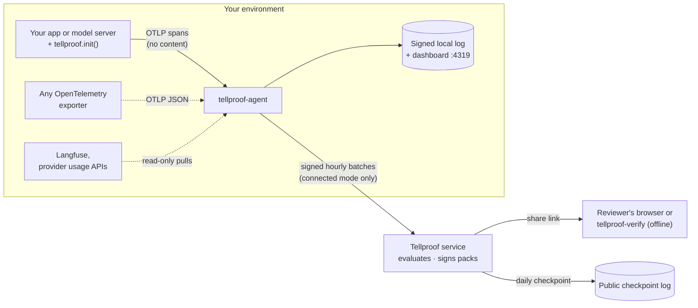
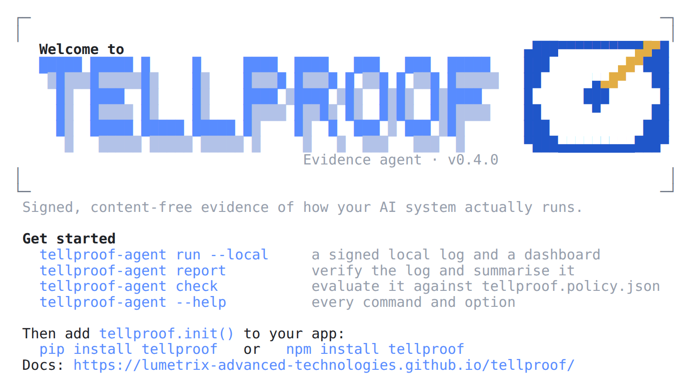
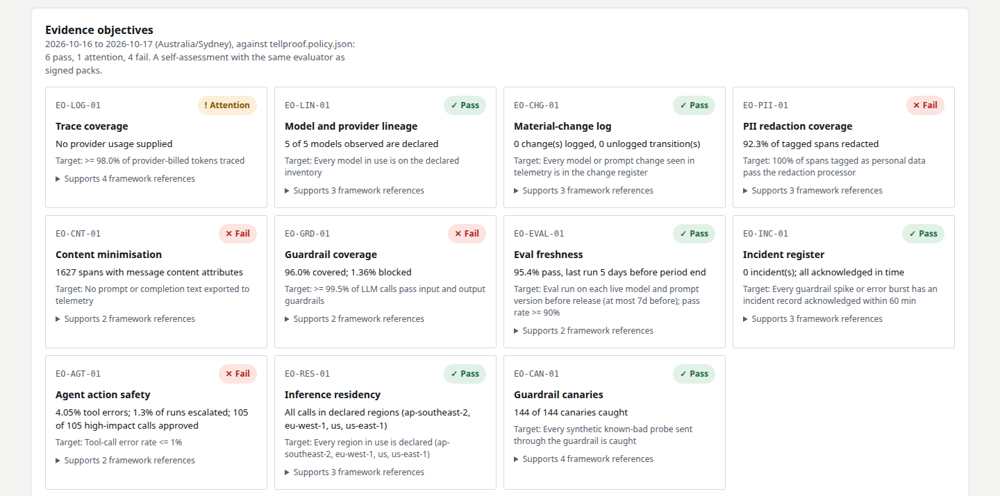

<p align="center">
  <picture>
    <source media="(prefers-color-scheme: dark)" srcset="docs/logo-dark.svg">
    
  </picture>
</p>

<h3 align="center">Signed, content-free evidence of how your AI system actually runs.</h3>

<p align="center">
  Add one line to an AI app, an agent or a model server. Get a tamper-evident, hour-by-hour record of every model call,<br>
  a local dashboard, governance checks for CI, and evidence a bank, insurer or auditor can verify without trusting you.
</p>

<p align="center">
  <a href="https://github.com/Lumetrix-Advanced-Technologies/tellproof/actions/workflows/ci.yml"></a>
  <a href="https://pypi.org/project/tellproof-agent/"></a>
  <a href="https://www.npmjs.com/package/tellproof-agent"></a>
  <a href="https://pypi.org/project/tellproof/"></a>
  <a href="https://www.npmjs.com/package/tellproof"></a>
  <a href="LICENSE"></a>
</p>

<p align="center">
  <a href="https://lumetrix-advanced-technologies.github.io/tellproof/"><b>Website</b></a> ·
  <a href="#quick-start-five-minutes-no-account"><b>Quick start</b></a> ·
  <a href="#instrument-your-app">Instrument</a> ·
  <a href="#the-dashboard">Dashboard</a> ·
  <a href="#governance-as-code-policy-check-and-ai-bom">Governance as code</a> ·
  <a href="#verify-a-pack">Verify a pack</a> ·
  <a href="#cli-reference">CLI</a> ·
  <a href="#security-model">Security</a>
</p>

<p align="center">
  <picture>
    <source media="(prefers-color-scheme: dark)" srcset="docs/dashboard-dark.png">
    
  </picture>
</p>

> [!IMPORTANT]
> **No content leaves your machine.** The SDKs never read prompts or completions, the agent drops message attributes the moment they arrive, and what it keeps is counts, short names and salted commitments. In local mode nothing is sent anywhere at all; `tellproof-agent run --dry-run` shows exactly what connected mode would send.

> [!NOTE]
> **Tellproof was called Plumbline until v0.2.** A tell is what gives something away; Tellproof evidence tells on itself: an edited or missing hour, a guardrail that stopped catching, a check that could never fail. Everything from v0.2 keeps working: `PLUMBLINE_*` variables, `plumbline.*` span attributes, `plumbline.policy.json` and a `.plumbline-agent` data directory are all still read, and batches, packs and keys are unchanged. See [Upgrading from Plumbline](#upgrading-from-plumbline).

## Why Tellproof

<table>
  <tr>
    <td width="33%" valign="top">
      <h4>🔌 One line, any stack</h4>
      <p><code>tellproof.init()</code> instruments the OpenAI, Anthropic and Bedrock clients you already use, in Python or Node.js, with no dependencies. Model vendors wrap their serving layer with one helper. OpenTelemetry works too.</p>
    </td>
    <td width="33%" valign="top">
      <h4>🔏 Tamper-evident by design</h4>
      <p>Every hour is a signed, chained batch with a Merkle commitment to its traces. Edit, drop or reorder one and verification fails, in the CLI, the dashboard and the browser verifier alike.</p>
    </td>
    <td width="33%" valign="top">
      <h4>📊 A dashboard, locally</h4>
      <p>Calls and tokens per model and region, guardrail coverage, personal-data redaction, agent tool use, changes and anomalies, served by the agent on loopback. No account, no SaaS.</p>
    </td>
  </tr>
  <tr>
    <td width="33%" valign="top">
      <h4>📐 Governance as code</h4>
      <p>Declare models, regions and registers in <code>tellproof.policy.json</code>. <code>tellproof-agent check</code> evaluates the eleven evidence objectives and fails CI when one fails, with a GitHub Action, and <code>aibom</code> writes a CycloneDX AI bill of materials from the evidence.</p>
    </td>
    <td width="33%" valign="top">
      <h4>🧪 Evidence that can fail</h4>
      <p>A check that cannot fail proves nothing. Guardrail canaries send known-bad probes through your own guardrail and record whether it caught them; <code>check --self-test</code> proves every objective fails on bad evidence and every tampering is caught.</p>
    </td>
    <td width="33%" valign="top">
      <h4>✅ Verifiable by anyone</h4>
      <p>Packs are DSSE-signed in-toto statements. Three independent verifiers (Go, browser, Python) agree on every published test vector, and the evaluator itself is open source.</p>
    </td>
  </tr>
</table>

### Local or hosted

| | Local mode (open source) | Hosted service (early access) |
| --- | :---: | :---: |
| One-line SDKs, agent, content dropped at parse time | ✓ | ✓ |
| Signed, chained hourly batches with trace commitments | ✓ | ✓ |
| Dashboard and terminal report | ✓ | ✓ |
| Policy file, `check` against the eleven objectives, CI gating, AI-BOM | ✓ | ✓ |
| Guardrail canaries and `check --self-test` | ✓ | ✓ |
| CI evidence per commit for coding agents (`ci`), with must-fail canaries | ✓ | ✓ |
| Evidence signed by an **independent issuer** (KMS-held key) | | ✓ |
| Monthly packs, chained, in a **public daily checkpoint** | | ✓ |
| Share links for reviewers, with view counts | | ✓ |
| Registers in an app, Vanta sync | | ✓ |
| Data leaves your environment | **never** | signed counts only |

## Contents

1. [Who it is for: use cases](#who-it-is-for-use-cases)
2. [How it works](#how-it-works)
3. [Quick start: five minutes, no account](#quick-start-five-minutes-no-account)
4. [Install](#install)
5. [Instrument your app](#instrument-your-app)
6. [Run the agent](#run-the-agent)
7. [The dashboard](#the-dashboard)
8. [Reports in the terminal](#reports-in-the-terminal)
9. [Governance as code: policy, check and AI-BOM](#governance-as-code-policy-check-and-ai-bom)
10. [Evidence for coding agents: CI gates per commit](#evidence-for-coding-agents-ci-gates-per-commit)
11. [Configuration reference](#configuration-reference)
12. [More evidence sources: Langfuse and provider usage](#more-evidence-sources-langfuse-and-provider-usage)
13. [What leaves your machine](#what-leaves-your-machine)
14. [Deploying the agent](#deploying-the-agent)
15. [Signed evidence packs: the hosted service (early access)](#signed-evidence-packs-the-hosted-service-early-access)
16. [Verify a pack](#verify-a-pack)
17. [Security model](#security-model)
18. [CLI reference](#cli-reference)
19. [Troubleshooting](#troubleshooting)
20. [Develop and contribute](#develop-and-contribute)
21. [Security reports and licence](#security-reports-and-licence)

---

## Who it is for: use cases

### You build an AI-powered app or agent

You call OpenAI, Anthropic, Amazon Bedrock or any OpenAI-compatible API, and your customers' security, risk and procurement teams keep asking the same questions.

| You need to show | What Tellproof records |
| --- | --- |
| **Which models and providers you use, and where they run** (vendor-risk questionnaires, data-residency clauses) | Calls and tokens per provider, model and region, every hour. Packs check them against the models and regions you declared. |
| **That guardrails run on every call** | For each model call, whether a guardrail decided on it (allow, block or flag), and how many were blocked. |
| **That personal data is removed before it reaches a model** | How many spans carried personal data, and how many of those were redacted first. |
| **That no prompt or completion text is kept** | Spans that arrive carrying message content are counted and the content dropped; the count is the evidence. |
| **What changed, and when** | Every model change and prompt-version change, with its time: a material-change log for your AI system. |
| **That evaluations are current** | Evaluation runs (suite, model, prompt version, pass rate, time), set against the models and prompt versions that were actually live. |
| **That an agent's actions are under control** | Agent runs, tool calls and tool errors, high-impact tool calls and how many were approved, hand-offs to a person. |
| **That nothing was left out** | A Merkle commitment to every trace in every hour, and token totals that can be reconciled with the provider's own billed usage. |
| **That the system is what you said it is** | A policy file in your repository declares the models and regions it may use and keeps the change, incident and evaluation registers; `tellproof-agent check` evaluates the evidence against the eleven evidence objectives and fails CI when one fails. |
| **An inventory of the AI you actually run** | `tellproof-agent aibom` writes a CycloneDX 1.6 AI bill of materials of every model declared or seen, with regions, volumes and first and last use. |
| **Operational awareness, privately** | A local dashboard of all of the above, hour by hour, without sending anything to a SaaS. |

### You are an AI model vendor or inference provider

You serve your own models (or host others') behind an API. Wrap each inference request in your serving layer with one helper, and you can show your customers which models and regions served their traffic, guardrail and redaction coverage on your side, and model changes over time. They can pass that evidence on to their own reviewers. See [For model vendors and inference providers](#for-model-vendors-and-inference-providers).

### You ship code written with coding agents

Claude Code, Copilot, Cursor and their peers now write a large share of commits, and reviewers want to know the same thing about all of it: did the checks actually run, and could they have caught a mistake? `tellproof-agent ci` records each CI gate's outcome per commit (exit status, duration, test counts; never logs, code or command lines), runs **must-fail canaries** that break the code on purpose and require the gate to fail, counts the commits that name a coding agent, and writes a signed in-toto statement per commit that anyone can check with `tellproof-agent ci verify` or `tellproof-verify ci`. See [Evidence for coding agents](#evidence-for-coding-agents-ci-gates-per-commit).

### You review AI vendors: bank, insurer, auditor, risk or procurement team

A vendor sends you a share link or a pack file. You check it yourself, in your browser or with an offline command, against the issuer's published keys: no account, no trust in the vendor, no trust in Tellproof. Three independent verifiers (Go, browser, Python) must agree on every [published test vector](spec/vectors/README.md), and you can write a fourth. See [Verify a pack](#verify-a-pack).

### You run security, platform or GRC for an AI product

- Audit exactly what the agent would send before you allow it: `tellproof-agent run --dry-run` prints every batch, decoded, and sends nothing.
- Run it with no network egress at all (local mode).
- Keep governance in code review: `tellproof.policy.json` sits next to the code, `tellproof-agent policy validate` checks it in CI, and `tellproof-agent check` (or the [GitHub Action](#in-ci)) gates releases on the eleven evidence objectives.
- Map results to framework references by ID (EU AI Act, ISO/IEC 42001, AIUC-1, CSA AICM and more; each objective lists the references it supports), hand auditors an AI-BOM, and, with the hosted service, keep your compliance platform (Vanta) up to date automatically.

---

## How it works



| Part | What it does |
| --- | --- |
| **SDKs** (`tellproof` for Python and Node.js) | `tellproof.init()` instruments the OpenAI, Anthropic and Bedrock client libraries you already use: one span per model call with provider, model, region, token counts, operation, timing and error status. **They never read message content.** Helpers add the facts no client library knows (prompt version, guardrail decision, redaction, tool approval). |
| **Agent** (`tellproof-agent`) | Runs next to your app. Receives spans on `127.0.0.1:4318`, drops every message attribute at parse time, aggregates per hour, commits every trace into a salted Merkle tree, and signs each hourly batch with its own Ed25519 key. |
| **Local mode** | The agent keeps the signed, chained batches in its data directory and serves a dashboard. Nothing is sent anywhere. |
| **Connected mode** | The agent sends the same signed batches to the Tellproof service, which evaluates eleven evidence objectives and issues signed, chained monthly packs. |
| **Verifiers** | `tellproof-verify` (offline command), the verify page (in the browser) and `concierge/verify.py` (an independent Python verifier). |

---

## Quick start: five minutes, no account

**1. Start the agent in local mode.** Pick whichever you already have:

```bash
pip install tellproof-agent && tellproof-agent run --local     # Python 3.8+
npx tellproof-agent run --local                                # Node.js 18+
docker run -d --name tellproof-agent -p 127.0.0.1:4318:4318 -p 127.0.0.1:4319:4319 \
  -v tellproof-agent:/data ghcr.io/lumetrix-advanced-technologies/tellproof-agent:latest run --local
```

In a terminal it greets you, then shows where it listens for spans, the dashboard address, where the signed evidence is kept, and its agent ID. Run `tellproof-agent` on its own for the welcome and first steps:

<p align="center">
  <picture>
    <source media="(prefers-color-scheme: dark)" srcset="docs/banner-dark.png">
    
  </picture>
</p>

The banner appears only in an interactive terminal (from v0.4.0). Pipes, files, CI and `TELLPROOF_NO_BANNER=1` get the plain lines and the JSON log, unchanged; `NO_COLOR` keeps the banner without colour.

**2. Add the SDK to your app.**

```bash
pip install tellproof        # Python 3.10+
npm install tellproof        # Node.js 18+
```

```python
import tellproof
tellproof.init()                 # once, at start-up, before your first model call
```

```js
import * as tellproof from 'tellproof';
tellproof.init();
```

**3. Make a model call, then open http://127.0.0.1:4319.** The first batch appears about a minute after the first call, and every hour after that.

> [!TIP]
> Next: declare what the system may use and check the evidence against the eleven objectives, in two commands: `tellproof-agent policy init`, then `tellproof-agent check`. See [Governance as code](#governance-as-code-policy-check-and-ai-bom). To share signed packs with reviewers, see [the hosted service](#signed-evidence-packs-the-hosted-service-early-access).

---

## Install

### The agent

| Method | Command | Notes |
| --- | --- | --- |
| **pip** | `pip install tellproof-agent` | Platform wheels for Linux (glibc and musl) x86_64 and aarch64, macOS 12+ x86_64 and arm64, Windows x64 and arm64. Each holds the release's static binary; nothing is compiled or downloaded at install time. `python -m tellproof_agent` works too. |
| **npm** | `npm install -g tellproof-agent`, or `npx tellproof-agent` | The right platform binary comes as an optional dependency; no install scripts. Don't install with `--omit=optional`. |
| **Docker** | `ghcr.io/lumetrix-advanced-technologies/tellproof-agent:<version>` | A static binary on distroless, non-root, for linux/amd64 and linux/arm64. Data in `/data`. |
| **Binary** | [Releases](https://github.com/Lumetrix-Advanced-Technologies/tellproof/releases) | `tellproof-agent-<os>-<arch>`; use `tellproof-agent-bedrock-*` for Amazon Bedrock usage from CloudWatch. |
| **Source** | `go install github.com/lumetrix-advanced-technologies/tellproof/cmd/agent@latest` | Go 1.26+. Add `-tags bedrock` for the Bedrock usage poller. |

### With npm

The agent and the SDK are both on npm, for Node.js 18 and later. npm, pnpm, Yarn and Bun all work.

```bash
npx tellproof-agent run --local            # try it without installing anything
npm install -g tellproof-agent             # or put it on your PATH ...
tellproof-agent                            # ... the welcome banner and first steps
tellproof-agent run --local

npm install --save-dev tellproof-agent     # or pin it per project: npx tellproof-agent run --local
npm install tellproof                      # the SDK, in your app
```

- **How it installs:** `tellproof-agent` is a small launcher; the binary for your platform comes in one of six packages (`tellproof-agent-linux-x64`, `-linux-arm64`, `-darwin-x64`, `-darwin-arm64`, `-win32-x64`, `-win32-arm64`) that npm picks through `optionalDependencies`. Nothing runs at install time: no install scripts, no downloads.
- **"no binary for …":** your platform is not one of those six, or optional dependencies were left out (`--omit=optional`, `--no-optional`, or `optional=false` in `.npmrc`). Reinstall without that, or use a [release binary](https://github.com/Lumetrix-Advanced-Technologies/tellproof/releases).
- **Upgrade and remove:** `npm install -g tellproof-agent@latest`; `npm uninstall -g tellproof-agent`. The data directory (`./.tellproof-agent`) is yours and stays where it is.
- **The SDK** ships CommonJS and ES modules with TypeScript types, and no dependencies: `import * as tellproof from 'tellproof'` or `const tellproof = require('tellproof')`.

### Check a download

Every release binary, `SHA256SUMS`, the release notes, the wheels, the npm tarballs and the container image carry signed build provenance (SLSA, through GitHub artifact attestations) that ties them to this repository's source and release workflows. npm packages published from the release workflow also carry npm provenance; v0.3.0's npm packages were published by hand from the release's attested tarballs, so check those against the tarballs on the release page.

```bash
sha256sum --ignore-missing -c SHA256SUMS
gh attestation verify tellproof-agent-linux-amd64 --repo Lumetrix-Advanced-Technologies/tellproof
gh attestation verify oci://ghcr.io/lumetrix-advanced-technologies/tellproof-agent:v0.2.0 --repo Lumetrix-Advanced-Technologies/tellproof
npm audit signatures            # in a project that installed tellproof-agent or tellproof
```

### The SDKs

```bash
pip install tellproof        # Python 3.10+, standard library only
npm install tellproof        # Node.js 18+, built-ins only; ESM and CommonJS; TypeScript types included
```

### The verifier

`tellproof-verify-<os>-<arch>` from [Releases](https://github.com/Lumetrix-Advanced-Technologies/tellproof/releases), or `go install github.com/lumetrix-advanced-technologies/tellproof/cmd/verify@latest`.

---

## Instrument your app

### Python

```python
import tellproof
tellproof.init()
```

`init()` takes optional arguments. It is safe to call more than once, and returns whether the SDK is on.

| Argument | Default | Meaning |
| --- | --- | --- |
| `agent_url` | `TELLPROOF_AGENT_URL`, else `http://127.0.0.1:4318` | Where the agent listens. |
| `service` | `TELLPROOF_SERVICE`, else `OTEL_SERVICE_NAME` | The service name on every span. |
| `environment` | `TELLPROOF_ENVIRONMENT` | The deployment environment, such as `production`. |
| `instrument` | `True` | Instrument the installed client libraries. `False` leaves only the helpers. |
| `stream_usage` | `False` | Ask OpenAI for usage on streamed chat completions (`stream_options.include_usage`) when the app has not set `stream_options`. The stream then ends with one extra chunk that has no `choices`. |

Other functions: `tellproof.flush(timeout=2.0)` sends buffered spans now; `tellproof.shutdown()` flushes and stops (it also runs at exit); `tellproof.is_enabled()`; `tellproof.stats()` returns counters (`spans`, `exported`, `dropped`, `export_errors`, `instrumentation_errors`, `instrumented`). `TELLPROOF_DISABLED=1` turns the SDK off without a code change. It works across threads, `asyncio` tasks and forked workers (gunicorn, uWSGI).

### Node.js and TypeScript

```js
import * as tellproof from 'tellproof';          // or: const tellproof = require('tellproof');
tellproof.init({ service: 'claims-api', environment: 'production' });
```

| Option | Default | Meaning |
| --- | --- | --- |
| `agentUrl` | `TELLPROOF_AGENT_URL`, else `http://127.0.0.1:4318` | Where the agent listens. |
| `service` | `TELLPROOF_SERVICE`, else `OTEL_SERVICE_NAME` | The service name on every span. |
| `environment` | `TELLPROOF_ENVIRONMENT` | The deployment environment. |
| `instrument` | `true` | Instrument the installed client libraries. |
| `streamUsage` | `false` | As `stream_usage` in Python. |

Other functions:

- `await tellproof.flush()`: call it before a serverless handler or a short script returns.
- `await tellproof.shutdown()`, `tellproof.isEnabled()`, `tellproof.stats()`.
- `await tellproof.ready()`: resolves once the ES-module copies of the client libraries are instrumented; await it if a module calls a model straight after `init()`.
- `tellproof.instrument({ openai: OpenAI, anthropic: Anthropic, bedrock: await import('@aws-sdk/client-bedrock-runtime') })`: for bundled apps, or strict package managers, where the SDK cannot find the libraries itself.

### What is instrumented automatically

| Library | Calls |
| --- | --- |
| `openai` (Python and Node.js) | `chat.completions.create` / `parse` / `stream`, `responses.create` / `parse` / `stream`, `embeddings.create`, `completions.create`; sync, async and streaming. Azure OpenAI is reported as `azure.ai.openai`, other OpenAI-compatible endpoints by their host name. |
| `anthropic` / `@anthropic-ai/sdk` | `messages.create` and `messages.stream`, and `beta.messages`. `AnthropicBedrock` and `AnthropicVertex` are reported as `aws.bedrock` and `gcp.vertex_ai`, with their region. |
| `boto3` Bedrock Runtime / `@aws-sdk/client-bedrock-runtime` | `converse`, `converse_stream`, `invoke_model`, `invoke_model_with_response_stream` (in Node.js, the matching `*Command`s through `client.send()`). A Converse call with `guardrailConfig` is a guarded call, blocked when the stop reason is `guardrail_intervened`. |

Per call, the SDK reads the request's model and stream flag, and from the response only the model, the usage block, the stop reason and Bedrock's token-count headers. Input tokens follow what the provider bills (Anthropic: uncached + cache writes + cache reads), so traced tokens can be reconciled with billed usage. Streams are recorded once, when they end. Calls through `invoke_model_with_response_stream` and `with_raw_response` are counted without tokens, because their counts sit only inside bodies the SDK never reads.

### Record what no client library knows

Tellproof's evidence objectives need a few facts only your code knows. In Python, each helper is a context manager (`with` / `async with`) and a decorator. In Node.js, it is a callback scope that returns whatever the callback returns, and follows `await`, timers and callbacks.

| Python | Node.js | Records |
| --- | --- | --- |
| `tellproof.trace()` | `trace(fn)` | Groups everything inside into one trace, for example one web request. |
| `tellproof.prompt(name, version)` | `prompt(name, version, fn)` | The prompt (name and version, never its text) used by calls inside. |
| `tellproof.personal_data(redacted=False)` | `personalData({ redacted }, fn)` | Spans inside handle personal data; `redacted` means it was removed or masked before the model saw it. |
| `tellproof.guardrail(decision=None)` | `guardrail(decision?, fn)` | The guardrail decision for calls inside: `allow`, `block` or `flag`, set later with `g.allow()`, `g.block()`, `g.flag()`. A block with no call inside counts as one blocked call. |
| `tellproof.tool(name, high_impact=False, approved=False)` | `tool(name, { highImpact, approved }, fn)` | A tool call; an exception marks it failed. Set `t.approved = True` once a person or policy approves it. |
| `tellproof.agent_run(name)` | `agentRun(name, fn)` | One agent run; model changes are tracked per agent. |
| `tellproof.escalation()` | `escalation()` | The request was handed to a person. |
| `tellproof.llm_call(provider, model, operation="chat", region=None)` | `llmCall({ provider, model, operation, region }, fn)` | A model call the SDK does not instrument; report its usage with `c.usage(input_tokens, output_tokens)`. |

```python
@app.post("/claims/{claim_id}/triage")
def triage(claim_id: str, req: Request):
    with tellproof.trace(), tellproof.prompt("claims-triage", "14"), tellproof.personal_data(redacted=True):
        with tellproof.guardrail() as g:
            if not input_policy_ok(req):
                g.block()                      # one blocked call; the model was never called
                return refusal()
            r = client.chat.completions.create(model="gpt-4.1-mini", messages=redact(req.messages))
            g.flag() if needs_review(r) else g.allow()
            return r

@tellproof.tool("issue_refund", high_impact=True)
def issue_refund(claim):
    ...
```

```js
app.post('/claims/:id/triage', (req, res) =>
  tellproof.trace(() =>
    tellproof.prompt('claims-triage', '14', () =>
      tellproof.personalData({ redacted: true }, () =>
        tellproof.guardrail(async (g) => {
          if (!inputPolicyOk(req.body)) { g.block(); return res.status(422).end(); }
          const r = await openai.chat.completions.create({ model: 'gpt-4.1-mini', messages: redact(req.body.messages) });
          needsReview(r) ? g.flag() : g.allow();
          res.json(r);
        })))));
```

Calls inside a `guardrail` scope are held until it ends, so a decision made after the call (an output check) still applies. Names and versions are capped at 128 characters.

### Guardrail canaries

Guardrail coverage (EO-GRD-01) shows a guardrail *ran* on every call. It cannot show the guardrail *works*: a guardrail that allows everything has full coverage. Canaries close that gap. The SDK passes a few synthetic, known-bad probes (a prompt injection, a jailbreak, made-up personal data, a documented example AWS key) to **your own guardrail check**, and records only the kind and whether it was caught. EO-CAN-01 passes when every canary was caught; a missed one fails it and names the kind.

```python
def guardrail_check(text: str) -> bool:      # your guardrail; True (or "block"/"flag") means it would stop the text
    return my_guardrail.scan(text).blocked

tellproof.schedule_canaries(guardrail_check, every=3600)   # now, then hourly, on a daemon thread
tellproof.run_canaries(guardrail_check)                     # or once, e.g. from a health check: {"pii": True, ...}
await tellproof.arun_canaries(async_guardrail_check)        # for an async check
tellproof.canary("toxicity", caught=True)                   # a canary you run yourself, with your own probe
```

```js
const check = async (text) => (await myGuardrail.scan(text)).blocked;
tellproof.scheduleCanaries(check, { every: 3_600_000 });   // now, then hourly, on an unref'd timer
await tellproof.runCanaries(check);                        // { prompt_injection: true, ... }
tellproof.canary('toxicity', true);
```

- **Only the result leaves.** The probe text stays in the process (it is in `tellproof.PROBES` and [`spec/canaries.json`](spec/canaries.json)); the span carries `tellproof.canary.kind` and `tellproof.canary.caught`, in its own trace, outside any scope of yours, so it never counts as a model call, personal data or a prompt version.
- **Send probes to the guardrail only, never to the model.** The check you pass should call your guardrail and nothing else.
- **A check that throws, or returns anything but `True`, `"block"` or `"flag"`, counts the canary as missed.** If your guardrail raises to block, catch that and return `True`.
- **Off means off.** With the SDK disabled the check is never called. Scheduled runs are at least a minute apart.
- Without canaries, EO-CAN-01 is *attention* ("No guardrail canaries run"), never fail.

### For model vendors and inference providers

If you serve models yourself, there is no client library to patch. Wrap each inference request in your serving layer with `llm_call`, naming your own provider and model, and report the tokens you already count:

```python
@app.post("/v1/chat/completions")
def chat(req):
    with tellproof.trace(), tellproof.llm_call("acme-ai", req.model, region="eu-west-1") as c:
        with tellproof.guardrail() as g:
            out = engine.generate(req)
            g.block() if out.filtered else g.allow()
        c.usage(out.prompt_tokens, out.completion_tokens)
        return out
```

```js
app.post('/v1/chat/completions', (req, res) =>
  tellproof.trace(() => tellproof.llmCall({ provider: 'acme-ai', model: req.body.model, region: 'eu-west-1' }, async (c) => {
    const out = await engine.generate(req.body);
    c.usage(out.promptTokens, out.completionTokens);
    res.json(out);
  })));
```

### Already on OpenTelemetry?

Skip the SDK and point an OTLP/HTTP **JSON** exporter at `http://127.0.0.1:4318/v1/traces`. The agent reads the OpenTelemetry GenAI conventions (old and new attribute names) and a few `tellproof.*` attributes, as listed in [`spec/semconv-map.json`](spec/semconv-map.json).

<details>
<summary><b>The attributes the agent reads</b></summary>

| Fact | Attributes the agent reads |
| --- | --- |
| Provider | `gen_ai.provider.name`, `gen_ai.system` |
| Model | `gen_ai.request.model`, `gen_ai.response.model` |
| Tokens | `gen_ai.usage.input_tokens` or `prompt_tokens`; `gen_ai.usage.output_tokens` or `completion_tokens` |
| Operation | `gen_ai.operation.name`, `llm.request.type` (`chat`, `text_completion`, `generate_content`, `embeddings`); `invoke_agent` and `execute_tool` mark agent runs and tool calls |
| Region | `cloud.region`, `aws.region` |
| Agent | `gen_ai.agent.name` |
| Prompt | `tellproof.prompt.name`, `tellproof.prompt.version` |
| Personal data | `tellproof.data_class` = `personal`; `tellproof.redaction.applied` |
| Guardrail | `tellproof.guardrail.decision` (`allow`, `block`, `flag`) |
| Tools | `tellproof.tool.high_impact`, `tellproof.tool.approved` |
| Escalation | `tellproof.escalation` |

</details>

Message attributes (`gen_ai.input.messages`, `gen_ai.output.messages`, `gen_ai.prompt*`, `gen_ai.completion*`, `llm.prompts.*`, `llm.completions.*`) are never read: their presence is counted and their values dropped at parse time. Use either the SDK or your exporter for the same calls, not both, or they are counted twice.

---

## Run the agent

### Modes

| Command | What it does |
| --- | --- |
| `tellproof-agent run --local` | **Local mode.** No account, server or token. Signs batches with its own key, keeps them in `<data-dir>/local`, and serves the dashboard on `127.0.0.1:4319`. Nothing is sent. (`tellproof-agent local` does the same.) |
| `tellproof-agent connect <token>` | **Connected mode, in one command.** Enrols with a one-time token from the Tellproof app (unless the data directory is already enrolled), keeps a salt secret in the data directory, then runs and sends signed batches to `TELLPROOF_SERVER`. Running it again later just runs. |
| `tellproof-agent enrol --config agent.json` | Enrol only, with the token from `--token` or `TELLPROOF_ENROL_TOKEN`. |
| `tellproof-agent run --config agent.json` | Run an enrolled agent with a config file (sources, aggregation settings). |
| `tellproof-agent run --config agent.json --dry-run` | Print every batch it would send, with its payload decoded; send, queue and store nothing. Works before enrolment. |
| `tellproof-agent run --config agent.json --dry-run --replay export.jsonl` | Feed an OTLP JSON export through the pipeline, print every window and exit: the fastest way to see what Tellproof would make of traces you already have. |
| `tellproof-agent report` | Verify and summarise the local log in the terminal. |
| `tellproof-agent check` | Evaluate the local log against the eleven evidence objectives and your policy ([governance as code](#governance-as-code-policy-check-and-ai-bom)). |
| `tellproof-agent aibom` | Write a CycloneDX AI bill of materials from the log. |
| `tellproof-agent dashboard --data-dir <dir>` | Serve the dashboard on its own for a data directory (a copied log, or one written elsewhere). |
| `tellproof-agent version` | Print the version. |

A local-mode data directory and an enrolled one never mix: `connect` refuses a local data directory, and local mode refuses an enrolled one. Local batches stay local; connecting starts a new agent with its own data directory.

### Hourly windows

Spans are aggregated into hourly windows (UTC). A window closes `grace_minutes` (default 5) after the hour, so late spans still count; spans later than that go into the next window and are counted as late. After a start, the open hour is also sent once, `first_batch_seconds` (default 60) after the first spans, so a new agent shows up at once. Windows are additive, so the rest of that hour follows when it closes. Each batch names the previous batch's digest and carries the next sequence number, so a lost, edited or replayed batch is detected.

---

## The dashboard

`tellproof-agent run --local` serves it on **http://127.0.0.1:4319**. It reads the same verified log as `report`, so the two can never disagree.

| Panel | Shows |
| --- | --- |
| **Status bar** | ✓ Verified or ✕ Failed (with the first problem), the number of batches, the agent ID, and when it last refreshed. |
| **Totals** | Model calls and models, tokens in and out, guardrail coverage and blocked calls, personal-data redaction, spans whose content was dropped, tool calls and failures, traces committed. |
| **Model calls** | Calls per hour (per day for long ranges), stacked by model, with a legend. The six busiest models keep their colours across ranges; the rest fold into "Other". |
| **Coverage** | Guardrail coverage and personal-data redaction over time, as percentages. |
| **Tokens** | Input and output tokens over time. |
| **Models and regions** | Every provider, model and region in the range, with calls, share and tokens. |
| **Timeline** | Model and prompt changes, anomaly hours (unusual error or guardrail-block rates) and evaluation runs. |
| **Evidence chain** | The newest batches, with sequence numbers, hours, calls, traces and full digests. |

Choose a range with the buttons (24 hours, 7 days, 30 days, All); a link can pick one with `#range=7d`. Hover a chart, or focus it and use the arrow keys, for an hour's figures; every chart also has a table view. It refreshes every 30 seconds, follows your system's light or dark theme, and works at phone width.

The agent serves it on loopback only. It answers only GET requests, refuses any request whose Host is not a local name (so a web page cannot read it through DNS rebinding), loads nothing from anywhere else, and stores nothing but your chosen range. Move it with `dashboard_listen` or `TELLPROOF_DASHBOARD_LISTEN`, or turn it off with `off`. To look at a log somewhere else: `tellproof-agent dashboard --data-dir /path/to/copy --listen 127.0.0.1:4320`.

---

## Reports in the terminal

```bash
tellproof-agent report                                  # the whole log
tellproof-agent report --since 2026-10-01 --until 2026-10-31
tellproof-agent report --json > october.json            # the same, as JSON
tellproof-agent report --data-dir /path/to/copy         # a copied log
docker exec tellproof-agent /tellproof-agent report     # inside the container
```

```
Tellproof local evidence log, agent agt_localf444634e45d1d9b9d0208705
  Verified: 2 batches, signed by this agent's key and chained from batch 1 to 2.
  Latest batch digest: sha256:00a34bc8802ae6135dbd64864373a0b3e391beb4b43e84199eb5786f631a6258
  Windows: 2026-09-01T00:00:00Z to 2026-09-01T02:00:00Z (UTC)

Model calls
  provider     model                        region          calls  input tokens  output tokens
  aws.bedrock  anthropic.claude-sonnet-4-5  ap-southeast-2  200    259900        60594
  openai       gpt-4.1-mini                 us-east-1       80     7200          320
  aws.bedrock  anthropic.claude-sonnet-4-6  ap-southeast-2  40     56780         12121

Guardrails      240 of 320 model calls had a guardrail decision (75.0%); 10 blocked
Personal data   54 of 60 spans with personal data were redacted (90.0%)
Content         240 spans arrived with message content; the agent dropped it
Agents          240 runs, 240 tool calls (8 failed), 24 high-impact calls (12 approved), 1 escalations
Traces          240 committed (salted Merkle roots; disclose one later from this data directory)
Change          2026-09-01T01:15:16Z: prompt 13 -> 14
Change          2026-09-01T01:40:13Z: model anthropic.claude-sonnet-4-5 -> anthropic.claude-sonnet-4-6
Anomaly         2026-09-01T00:00:00Z to 2026-09-01T01:00:00Z: guardrail_rate
```

The report checks every batch's signature against `agent.pub`, that the sequence runs from 1 without gaps, that each batch names the previous batch's digest, and that no batch is missing from the end. If any check fails it says where, and exits **1**, so it can gate a CI job or a cron alert. `--since` and `--until` limit the figures, never the checks.

> [!NOTE]
> A local log proves it has not changed since it was written, relative to `agent.pub`. Keep a copy of `agent.pub` somewhere else, or give it to a reviewer up front. For evidence signed by an independent issuer, see [the hosted service](#signed-evidence-packs-the-hosted-service-early-access).

---

## Governance as code: policy, check and AI-BOM

Write down what your AI system is meant to be, next to its code, and check the evidence against it: locally, in CI, and with the same evaluator that issues signed packs, so your own check and a reviewer's pack cannot disagree.

### 1. Declare: `tellproof.policy.json`

```bash
tellproof-agent policy init --name "Claims Triage Agent" --timezone Australia/Sydney
```

This writes a policy declaring the models and regions the log has seen.

> [!WARNING]
> Review it before you rely on it. A declaration says what the system *may* use, so remove anything that should not be there. `policy init` never fills the registers: a change or an incident is something a person records.

<details open>
<summary><b>An example <code>tellproof.policy.json</code></b></summary>

```json
{
  "$schema": "https://raw.githubusercontent.com/Lumetrix-Advanced-Technologies/tellproof/main/spec/policy.schema.json",
  "organisation": "Kestrel Insurance",
  "ai_system": "Claims Triage Agent",
  "environment": "production",
  "timezone": "Australia/Sydney",
  "declared_models": [
    { "provider": "openai", "model": "gpt-4.1-mini", "role": "triage" },
    { "provider": "aws.bedrock", "model": "anthropic.claude-sonnet-4-6", "role": "summaries" }
  ],
  "declared_regions": ["us-east-1", "ap-southeast-2"],
  "changes": [
    { "date": "2026-10-14", "kind": "model", "what": "Summaries moved from Sonnet 4.5 to 4.6 after the regression suite passed" }
  ],
  "incidents": [
    { "id": "INC-42", "opened": "2026-10-13T03:10:00Z", "acknowledged": "2026-10-13T03:25:00Z", "summary": "Guardrail block spike after a prompt deploy" }
  ],
  "evals": [
    { "suite": "triage-regression", "model": "gpt-4.1-mini", "prompt_version": "14", "ran_at": "2026-10-12T00:00:00Z", "pass_rate": 0.96 }
  ],
  "ci": { "required_gates": ["lint", "tests"], "canary_gates": ["tests"] }
}
```

</details>

| Field | Used by | Meaning |
| --- | --- | --- |
| `ai_system`, `organisation`, `environment` | all | Who and what is being assessed. |
| `timezone` | all | IANA time zone for periods and change dates (default UTC). |
| `declared_models` | EO-LIN-01, AI-BOM | Every model the system may use, as the agent reports provider and model; `role` is optional. |
| `declared_regions` | EO-RES-01 | Every region inference may run in. |
| `changes` | EO-CHG-01 | The material-change register: each model or prompt change, by local date (`kind` is `model` or `prompt`). A change the telemetry shows matches an entry of the same kind within a day. |
| `incidents` | EO-INC-01 | The incident register. An anomaly hour is covered by an incident opened within an hour of it and acknowledged within an hour of opening. |
| `evals` | EO-EVAL-01 | Evaluation runs recorded outside the telemetry, added to those the agent sees (Langfuse scores, SDK spans). |
| `ci` | `ci verify` | Optional. `required_gates` must have run and passed on every commit; each of `canary_gates` must have had its must-fail canary caught ([coding-agent evidence](#evidence-for-coding-agents-ci-gates-per-commit)). |

The [JSON Schema](spec/policy.schema.json) gives editors completion and validation; `tellproof-agent policy validate` checks the file the way `check` reads it (unknown keys are refused, so a typo never silently weakens a declaration). The agent looks for the policy at `--policy`, then `$TELLPROOF_POLICY`, then `./tellproof.policy.json`, then `<data-dir>/tellproof.policy.json` (where a container keeps it).

### 2. Check: `tellproof-agent check`

```bash
tellproof-agent check                                   # the last 30 days with data
tellproof-agent check --since 2026-10-01 --until 2026-10-31 --junit check.xml
tellproof-agent check --json > october-check.json
tellproof-agent check --strict                          # attention fails too
```

```
Tellproof check: Claims Triage Agent (production), 2026-10-09 to 2026-10-17 (Australia/Sydney)
  Evidence: 168 batches from agent agt_locald74e27b542973a66bedec4fc, verified (signatures and chain).

! ATTENTION  EO-LOG-01  Trace coverage
             No provider usage supplied
             target: >= 98.0% of provider-billed tokens traced
             supports: EU AI Act Art. 12 Record-keeping (automatic logging); ISO/IEC 42001 A.6.2.8 AI system event logs*; ...
✓ PASS       EO-LIN-01  Model and provider lineage
             6 of 6 models observed are declared
             target: Every model in use is on the declared inventory
✕ FAIL       EO-CHG-01  Material-change log
             0 change(s) logged, 2 unlogged transition(s)
             target: Every model or prompt change seen in telemetry is in the change register
             missing change: 2026-10-14T03:17:00Z model anthropic.claude-sonnet-4-5 -> anthropic.claude-sonnet-4-6 (add to "changes")
...
2 pass, 1 attention, 7 fail.
* Framework mapping not yet verified against the framework's text.
```

The log is verified first; a log that fails verification is never evaluated. Each objective shows what was measured, its target, the framework references it supports, and, where a register is short, exactly which entries are missing. Exit status: **0** no objective failed (with `--strict`, none needs attention either), **1** one did or the log failed verification, **2** a usage or policy error. `--junit` writes one test case per objective for any CI test reporter.

The dashboard shows the same check for the selected range in its **Evidence objectives** panel, re-read on every refresh, so a policy edit shows at once:

<picture>
  <source media="(prefers-color-scheme: dark)" srcset="docs/objectives-dark.png">
  
</picture>

> [!NOTE]
> `check` is a self-assessment: the evidence is signed by your own agent's key and evaluated by you. A [pack](#signed-evidence-packs-the-hosted-service-early-access) is the same evaluation, signed by an independent issuer.

### Prove it can fail: `check --self-test`

A green check is worth something only if the same check would have gone red. `--self-test` asks that of your own evidence and policy: for each objective it adds the least synthetic evidence that should fail it (an undeclared model, unredacted personal data, a missed canary, an unregistered change, ...) to a copy of the input and evaluates again, and it tampers with a copy of the log (an edited number, a batch re-signed with another key, a missing batch) and requires verification to refuse each one. Your log and policy are never changed, and the agent's private key is never copied.

```bash
tellproof-agent check --self-test
tellproof-agent check --self-test --json > self-test.json
```

```
Tellproof self-test: Claims Triage Agent, 2026-10-09 to 2026-10-17
  Can each objective fail on this evidence and policy? A violation is added to a copy of the evidence; the objective must fail.

✓ CAN FAIL     EO-LIN-01  Model and provider lineage (now pass)
               added one call to an undeclared model: fail
✕ VACUOUS      EO-CHG-01  Material-change log (now pass)
               the change register has a model and a prompt change within a day of every day in the period, so no change can ever be unlogged
✓ CAN FAIL     EO-CAN-01  Guardrail canaries (now pass)
               added 14500 guardrail canaries missed: fail
...
Is tampering with the log detected?
✓ DETECTED     one number edited in the newest batch
✓ DETECTED     the newest batch re-signed with another key
✓ DETECTED     the first batch removed

10 of 11 objectives can fail; 1 vacuous, 0 cannot fail, 0 untested.
```

**Vacuous** is the finding to act on: a register written so that nothing could ever be missing from it (a change logged for every day, an incident open every hour) turns its objective into a rubber stamp. Exit status **1** for a vacuous or unfailable objective or undetected tampering, so the self-test can run in CI next to `check`. Two limits are printed with every run: deleting the newest batches cannot be detected from the log alone (the hosted chain and daily public checkpoints catch that), and the self-test cannot show the telemetry itself is complete, which is what trace coverage and canaries measure.

### In CI

The repository is also a GitHub Action. Validate the policy on every pull request that changes it:

```yaml
- uses: Lumetrix-Advanced-Technologies/tellproof@v0.3.0
  with: { command: validate, policy: tellproof.policy.json }
```

Or gate a release on the evidence, with a copy of the agent's data directory (from a scheduled job, an artifact or a volume snapshot):

```yaml
- uses: Lumetrix-Advanced-Technologies/tellproof@v0.3.0
  with: { command: check, policy: tellproof.policy.json, data-dir: evidence/, strict: "true" }
```

Add `command: self-test` as a second step to show the check could have failed.

It installs `tellproof-agent` from PyPI, writes `tellproof-check.xml` (JUnit), puts the result in the job summary, and fails the job when an objective fails.

### 3. Inventory: `tellproof-agent aibom`

```bash
tellproof-agent aibom --out aibom.cdx.json
tellproof-agent aibom --since 2026-10-01 --until 2026-10-31 > october.cdx.json
```

A [CycloneDX 1.6](https://cyclonedx.org/) AI bill of materials, built from the verified log rather than a hand-kept list. The AI system is the root component; every model declared or seen is a `machine-learning-model` component with its provider as supplier and properties for whether it was declared and observed, its regions, calls, input and output tokens, first and last hour seen, and prompt versions. A model that is declared but never seen, or seen but never declared, is visible at a glance. The BOM's metadata names the agent and the latest batch digest it was built from. Any CycloneDX tool can read it (Dependency-Track, the CycloneDX CLI, SBOM platforms).

## Evidence for coding agents: CI gates per commit

A green CI badge says the last run passed. It does not say which checks ran on *this* commit, whether the test step ran any tests, or whether the tests could have caught a broken change. That matters more as coding agents write more of the code. `tellproof-agent ci` turns a CI run into evidence about one commit:

| Command | What it does |
| --- | --- |
| `ci run --gate <name> [--junit <file>] -- <command>` | Runs a gate (tests, lint, a scan) with its output and exit status passed straight through, and records the gate's name, exit status, duration, a SHA-256 of the command line and, with `--junit`, the report's counts (cases counted, not the summary attributes). Never the output, the code or the command line itself. |
| `ci canary --gate <name> --patch <file> -- <command>` | A **must-fail canary**: applies a patch that breaks the code to a temporary worktree (your checkout is untouched), runs the same gate there and requires it to **fail**. Exit 0 when the gate caught the breakage, 1 when it passed (the gate cannot tell broken code from working code). |
| `ci attest [--base <rev>] [--key <file> \| --unsigned]` | Writes the commit's in-toto statement: every gate and canary (the latest run of each, with the number of runs, so a gate retried until green shows it), the CI run and its URL, and how many commits in `base..HEAD` name a coding agent (Claude, Copilot, Cursor, Aider, Devin, Codex, Gemini, Jules, Amazon Q), by name and count only. Signed with an Ed25519 key in a DSSE envelope, or bare for GitHub artifact attestations. |
| `ci verify [--pub <file> \| --unsigned] <statement>` | Checks the signature, the commit (the checked-out one by default), that every required gate passed, that a test gate ran at least one test and has no failing tests in its report, and that every canary gate's canary was caught. Requirements come from the policy's `ci` section or `--require` and `--canary`. |
| `ci keygen --out <file>` | Makes a signing key (and `<file>.pub`). Store the key as a CI secret, `TELLPROOF_CI_KEY`; publish the public key. |

```bash
tellproof-agent ci run --gate lint -- golangci-lint run
tellproof-agent ci run --gate tests --junit report.xml -- pytest --junitxml=report.xml   # or gotestsum --junitfile report.xml
tellproof-agent ci canary --gate tests --patch ci/canaries/skip-auth-check.patch -- pytest tests/test_auth.py
tellproof-agent ci attest --base origin/main --out ci-evidence.json             # signed with $TELLPROOF_CI_KEY
tellproof-agent ci verify --pub ci.pub ci-evidence.json
```

```
Tellproof CI evidence: git+https://github.com/acme/app at 421bbd4a7238b1db67d8384bc838a373143a4728 (signature verified)
  Run: https://github.com/acme/app/actions/runs/1234567
✓ OK   commit                   statement is for 421bbd4a7238…, expected 421bbd4a7238…
✓ OK   gate lint                passed
✓ OK   gate tests               passed: 412 tests, 3 skipped
✓ OK   canary tests             caught: the gate failed on known-bad input (exit 1)
Coding agents: 4 of 5 commits in origin/main..421bbd4a7238… name one (claude 4).
```

A canary patch is a small, deliberate bug in code that matters: an authorisation check removed, a boundary flipped, a validation skipped. Keep a few under `ci/canaries/`; if a canary stops being caught, your tests stopped covering that code. Add `.tellproof-ci/` (where runs are recorded until `attest`) to `.gitignore`.

<details>
<summary><b>A GitHub workflow</b>, signed with GitHub artifact attestations (no key to manage)</summary>

```yaml
permissions: { contents: read, id-token: write, attestations: write }
steps:
  - uses: actions/checkout@v4
    with: { fetch-depth: 0 }
  - run: pip install tellproof-agent
  - run: tellproof-agent ci run --gate lint -- make lint
  - run: tellproof-agent ci run --gate tests --junit report.xml -- make test-junit
  - run: tellproof-agent ci canary --gate tests --patch ci/canaries/skip-auth-check.patch -- make test
  - run: tellproof-agent ci attest --unsigned --base origin/${{ github.base_ref || 'main' }} --out ci-evidence.json --predicate ci-predicate.json
  - uses: actions/attest@v2
    with:
      subject-path: ci-evidence.json
      predicate-type: https://lumetrix.example/tellproof/ci/v0.1
      predicate-path: ci-predicate.json
  - run: tellproof-agent ci verify --unsigned ci-evidence.json   # gate the merge on the policy's ci section
```

Anyone can then check it: `gh attestation verify ci-evidence.json -R acme/app`, then `tellproof-verify ci --unsigned --commit <sha> --require lint,tests --canary tests ci-evidence.json`.

</details>

---

## Configuration reference

`run --local` and `connect` need no file. For anything more, write a JSON file and pass `--config agent.json`.

<details>
<summary><b>A complete config file, with every source off</b> (<a href="agent.example.json"><code>agent.example.json</code></a>)</summary>

```json
{
  "server": "https://<server>",
  "data_dir": "./.tellproof-agent",
  "otlp_listen": "127.0.0.1:4318",
  "dashboard_listen": "127.0.0.1:4319",
  "langfuse": { "enabled": false, "base_url": "https://cloud.langfuse.com",
                "public_key_env": "LANGFUSE_PUBLIC_KEY", "secret_key_env": "LANGFUSE_SECRET_KEY", "eval_scores": [] },
  "usage": {
    "openai":    { "enabled": false, "admin_key_env": "OPENAI_ADMIN_KEY", "project_ids": [] },
    "anthropic": { "enabled": false, "admin_key_env": "ANTHROPIC_ADMIN_KEY", "workspace_ids": [] },
    "bedrock":   { "enabled": false, "region": "ap-southeast-2" }
  },
  "salt_secret_env": "TELLPROOF_SALT_SECRET",
  "salt_secret_file": "",
  "aggregation": { "grace_minutes": 5, "first_batch_seconds": 60,
                   "anomaly": { "min_calls": 20, "error_rate": 0.05, "guardrail_block_rate": 0.03 } }
}
```

</details>

| Key | Default | Meaning |
| --- | --- | --- |
| `server` | none | The Tellproof server, for connected mode. `https`, or `http` for localhost only. |
| `data_dir` | `./.tellproof-agent` (`/data` in the container) | The key, queue, local log, commitment leaves and salt. |
| `otlp_listen` | `127.0.0.1:4318` | The span receiver. A non-loopback address needs `otlp_allow_remote`. |
| `otlp_allow_remote` | `false` | Allow listening beyond loopback. The receiver has no authentication, so do this only on a network you control. |
| `dashboard_listen` | `127.0.0.1:4319` | The local-mode dashboard; `off` turns it off. Same loopback rule. |
| `langfuse.*` | off | The [Langfuse puller](#langfuse). |
| `usage.*` | off | The [provider usage pollers](#provider-usage). |
| `salt_secret_env` / `salt_secret_file` | `TELLPROOF_SALT_SECRET` | The secret that salts trace commitments. With `connect` or `run --local` and none set, a random one is kept in `<data-dir>/salt.secret`. |
| `aggregation.grace_minutes` | `5` | How long after the hour a window stays open (1 to 55). |
| `aggregation.first_batch_seconds` | `60` | When the open hour is sent once after a start (0 to 3600). |
| `aggregation.anomaly.*` | `20`, `0.05`, `0.03` | An hour with at least `min_calls` calls and an error rate or guardrail-block rate above these is an anomaly window. |

Secrets are never written in the file. Each `*_env` key names the environment variable that holds a secret, and the salt can come from a file with mode `0600`.

### Environment variables

| Variable | Overrides | Notes |
| --- | --- | --- |
| `TELLPROOF_SERVER` | `server` | |
| `TELLPROOF_DATA_DIR` | `data_dir` | |
| `TELLPROOF_OTLP_LISTEN` | `otlp_listen` | |
| `TELLPROOF_DASHBOARD_LISTEN` | `dashboard_listen` | |
| `TELLPROOF_OTLP_ALLOW_REMOTE=1` | `otlp_allow_remote` | Set in the container image, whose documented commands publish ports on the host's loopback only. |
| `TELLPROOF_ENROL_TOKEN` | | The token for `enrol` and `connect` when it is not given on the command line. |
| `TELLPROOF_SALT_SECRET` | | The default salt variable. |
| `TELLPROOF_NO_BANNER=1` | | No welcome banner, even in a terminal (also off in pipes, files, CI and `TERM=dumb`). `NO_COLOR` keeps it without colour. |
| SDK: `TELLPROOF_AGENT_URL`, `TELLPROOF_SERVICE`, `TELLPROOF_ENVIRONMENT`, `TELLPROOF_DISABLED` | | See [Instrument your app](#instrument-your-app). |

---

## More evidence sources: Langfuse and provider usage

Each source is read-only and off until you turn it on. Content is dropped the same way as for spans.

### Langfuse

```json
"langfuse": { "enabled": true, "base_url": "https://cloud.langfuse.com",
              "public_key_env": "LANGFUSE_PUBLIC_KEY", "secret_key_env": "LANGFUSE_SECRET_KEY",
              "eval_scores": [ { "name": "faithfulness", "suite": "rag-eval", "pass_at_least": 0.8 } ] }
```

The agent pulls traces from your Langfuse project with its keys. `eval_scores` turns Langfuse scores into evaluation runs: scores named `name` are recorded as runs of `suite`, passing when the score is at least `pass_at_least`.

### Provider usage

```json
"usage": {
  "openai":    { "enabled": true, "admin_key_env": "OPENAI_ADMIN_KEY", "project_ids": ["proj_..."] },
  "anthropic": { "enabled": true, "admin_key_env": "ANTHROPIC_ADMIN_KEY", "workspace_ids": ["wrkspc_..."] },
  "bedrock":   { "enabled": true, "region": "ap-southeast-2" }
}
```

The agent polls the providers' usage APIs with an admin key (limit it to this system's projects or workspaces) and puts each hour's billed tokens in the batch, so traced tokens can be compared with billed ones: that is the trace-coverage objective. Bedrock usage comes from CloudWatch in `region`, with the default AWS credential chain, and needs a `tellproof-agent-bedrock-*` binary (or `-tags bedrock`).

---

## What leaves your machine

**In local mode, nothing.** In connected mode, one signed batch per hour, defined by [`spec/batch.schema.json`](spec/batch.schema.json) (`plumbline-batch/v0.2`), or, for an hour with guardrail canaries, [`spec/batch-v0.3.schema.json`](spec/batch-v0.3.schema.json), which adds `"canaries": [{"kind": "pii", "run": 1, "caught": 1}]`: counts per kind, never the probes.

<details>
<summary><b>A real batch, trimmed</b> (<code>tellproof-agent run --dry-run</code> shows yours)</summary>

```json
{
  "schema": "plumbline-batch/v0.2",
  "agent_id": "agt_dryrun0000000000",
  "seq": 1,
  "prev": null,
  "window": { "start": "2026-09-01T00:00:00Z", "end": "2026-09-01T01:00:00Z" },
  "metrics": {
    "tokens": [ { "provider": "aws.bedrock", "model": "anthropic.claude-sonnet-4-5", "region": "ap-southeast-2",
                  "calls": 120, "input_tokens": 151140, "output_tokens": 36357 } ],
    "pii": { "pii_spans": 30, "pii_spans_redacted": 27 },
    "content_present_spans": 120,
    "guardrails": { "llm_calls": 160, "guarded_calls": 120, "blocked": 5 },
    "agent": { "runs": 120, "tool_calls": 120, "tool_errors": 4, "high_impact_calls": 12, "high_impact_approved": 6, "escalations": 1 }
  },
  "commit": { "root": "0d98141acd04af7a42b105bc3ea41d751f0e8227e6baa89bcf716dc946dc701a", "leaves": 120 }
}
```

</details>

A full batch also lists evaluation runs, model and prompt changes, anomaly windows, which models and prompt versions were live, late spans and provider usage. It **never** contains:

- prompts, completions, messages or any span content;
- tool arguments, return values or exception messages;
- end-user identifiers, IP addresses or request bodies;
- raw trace IDs.

Each trace becomes a leaf `sha256(0x00 ‖ salt ‖ trace_id)`, where the salt is derived from a secret that stays with you. The commitment reveals nothing, yet a single trace can later be disclosed and proved to be in it.

### The data directory

| File | What it is |
| --- | --- |
| `agent.key` (0600) | The agent's Ed25519 private key. It signs every batch; losing it means a new agent. |
| `agent.json` | The agent ID (and the server, when enrolled). |
| `agent.pub` | Local mode: the public key, to verify the log without the private key. |
| `local/` | Local mode: the signed, chained batches, never sent. |
| `queue/` | Connected mode: batches the server has not accepted yet, fsynced before they are acknowledged and retried with backoff of up to 15 minutes. |
| `leaves/` | Each window's commitment leaves, for disclosing a trace later. |
| `salt.secret` (0600) | The salt secret, when the agent made one. |

Keep and back up the data directory. In the container it is the `tellproof-agent` volume.

---

## Deploying the agent

### Next to the app on one host

Run the agent as a service (systemd, launchd, or a container with `--restart unless-stopped`) and leave the defaults: the SDK finds it on `127.0.0.1:4318`.

### Docker Compose

```yaml
services:
  app:
    build: .
    environment:
      TELLPROOF_AGENT_URL: http://tellproof-agent:4318
      TELLPROOF_SERVICE: claims-api
      TELLPROOF_ENVIRONMENT: production
  tellproof-agent:
    image: ghcr.io/lumetrix-advanced-technologies/tellproof-agent:v0.2.0
    command: ["run", "--local"]                 # or ["connect", "<token>"], with TELLPROOF_SERVER set
    ports: ["127.0.0.1:4319:4319"]              # the dashboard, on the host's loopback only
    volumes: ["tellproof-agent:/data"]
volumes:
  tellproof-agent: {}
```

### Kubernetes

Run the agent as a sidecar in the app's pod, so spans never leave the pod, and keep the data directory on a persistent volume.

```yaml
containers:
  - name: app
    env:
      - { name: TELLPROOF_AGENT_URL, value: "http://127.0.0.1:4318" }
  - name: tellproof-agent
    image: ghcr.io/lumetrix-advanced-technologies/tellproof-agent:v0.2.0
    args: ["run", "--local"]
    volumeMounts: [{ name: tellproof-data, mountPath: /data }]
```

`kubectl port-forward pod/<pod> 4319` opens the dashboard. If one agent serves several pods, restrict who can reach port 4318 with a NetworkPolicy: the receiver has no authentication.

### Serverless and short scripts

Call `tellproof.flush()` (in Node.js, `await tellproof.flush()`) before the handler returns, and run the agent where the function can reach it, set with `TELLPROOF_AGENT_URL`.

---

## Signed evidence packs: the hosted service (early access)

The local log is signed by your own key, and `tellproof-agent check` is your own evaluation of it. Reviewers usually need evidence signed by someone other than the vendor. That is what the hosted Tellproof service adds: the same evaluation, signed by an independent issuer, chained month to month and listed in a public checkpoint.

> [!NOTE]
> The hosted service is in early access. [Request access](https://github.com/Lumetrix-Advanced-Technologies/tellproof/issues/new?template=early-access.yml); everything else on this page works today without it.

### What you get

**Eleven evidence objectives**, evaluated for each AI system over each period:

| ID | Objective | Passes when |
| --- | --- | --- |
| EO-LOG-01 | Trace coverage | Traced tokens are at least 98% of the provider's billed tokens. |
| EO-LIN-01 | Model and provider lineage | Every model seen was declared. |
| EO-CHG-01 | Material-change log | No model or prompt change is missing from the change register. |
| EO-PII-01 | PII redaction coverage | Every span with personal data was redacted. |
| EO-CNT-01 | Content minimisation | No span reached the agent carrying message content. |
| EO-GRD-01 | Guardrail coverage | At least 99.5% of model calls had a guardrail decision. |
| EO-EVAL-01 | Eval freshness | Every live model and prompt version passed an evaluation (pass rate at least 0.9) in the last 7 days. |
| EO-INC-01 | Incident register | Every anomaly hour was acknowledged in the incident register. |
| EO-AGT-01 | Agent action safety | Tool calls fail at most 1% of the time. |
| EO-RES-01 | Inference residency | Every region seen was declared. |
| EO-CAN-01 | Guardrail canaries | Every synthetic known-bad probe sent through the guardrail was caught ([canaries](#guardrail-canaries)). |

Results near a threshold are marked *attention* rather than pass or fail. Each objective lists the framework references it supports, by ID (for example ISO/IEC 42001 controls): see [`spec/objectives.json`](spec/objectives.json) and [`spec/framework-refs.json`](spec/framework-refs.json).

Besides the objectives:

- **Monthly packs.** An in-toto statement in a DSSE envelope over canonical JSON (RFC 8785), signed with an ECDSA P-256 key held in AWS KMS, chained to the previous pack by digest, with a Merkle commitment to the period's traces.
- **Share links** for reviewers, which expire and can be revoked, with view counts.
- **A public daily checkpoint** of every pack digest issued that day, signed and chained, so a pack cannot be backdated quietly.
- **Vanta:** an hourly sync of each objective's status with a verify link, and the packs as documents.

### The workflow, step by step

1. [Request early access](https://github.com/Lumetrix-Advanced-Technologies/tellproof/issues/new?template=early-access.yml), and pick what fits: hosted packs, design partner, evidence for models you serve, or reviewer.
2. In the Tellproof app, create your organisation and an AI system, and declare its models, regions and timezone.
3. Create an enrolment token on the system's *Setup and sources* page. The page shows the exact command.
4. Run the agent with it: `TELLPROOF_SERVER=https://<server> tellproof-agent connect <token>`, or the `docker run` line the page shows. Keep the SDK line in your app as before.
5. Record changes, incidents and evaluation runs in the system's registers (by form or CSV upload), so the change and incident objectives have something to compare with.
6. Issue a pack for a period (by default, the previous calendar month).
7. Create a share link for a reviewer (for one pack, or always the latest) and send it.
8. The reviewer opens it, and the verify page checks the pack in their browser. Or they download it and run `tellproof-verify`.
9. Optionally, connect Vanta in Settings.

---

## Verify a pack

### In the browser

Open a share link: the verify page fetches the pack and the issuer's keys, and checks everything in your browser with Web Crypto. Or open the verify page with no link, choose the issuer's JWKS file and one or more pack files, and it checks them offline, with no network at all. It shows a pack's contents only after its signature verifies.

### Offline, with tellproof-verify

```bash
tellproof-verify --jwks issuer-jwks.json pack.dsse.json
tellproof-verify --jwks https://<issuer>/.well-known/jwks.json 2026-09.dsse.json 2026-10.dsse.json   # oldest first: also checks the chain
tellproof-verify --json --jwks issuer-jwks.json pack.dsse.json                                      # a machine-readable report
```

```
spec/vectors/pass/KST-CTA-0002.dsse.json
  pack ................. KST-CTA-0002 (seq 2)
  digest ............... sha256:91ceb4233b19d3164c6a58292166c052cae2a5cf1cfa680b55f4ad5f6bb9c7c8
  signature ............ valid (key test-p256-2026-10)
  subject digest ....... matches the pack contents
  chain link ........... links to the previous pack
  disclosed trace ...... included in the commitment
  result ............... VERIFIED
RESULT: VERIFIED
```

It checks the issuer's signature (against a key that was valid when the pack was issued and has not been revoked), that the subject digest matches the contents, the link to the previous pack, and any disclosed trace's Merkle proof. Exit status: **0** all verified, **1** a check failed, **2** a usage or input error.

**Prove a pack is in a daily checkpoint:**

```bash
tellproof-verify checkpoint --jwks issuer-jwks.json --prev 2026-10-15.json 2026-10-16.json pack.dsse.json
```

This checks the checkpoint's signature, its Merkle root and its link to the previous day, and that each pack given is in it.

### In Python

```bash
pip install cryptography
python3 concierge/verify.py issuer-jwks.json pack.dsse.json
```

### Write your own verifier

[`spec/vectors/README.md`](spec/vectors/README.md) gives the formats and the four manifests every verifier must match: pass and fail packs, extra cases, key-validity cases and canonical-JSON cases. If your verifier disagrees with ours on any case, one of us has a bug: please [report it privately](SECURITY.md).

---

## Security model

- **No content leaves the customer.** The SDKs never read message content, the agent drops message attributes at parse time, and batches carry only counts, short names and commitments. `--dry-run` shows exactly what would be sent.
- **One destination.** In connected mode the agent sends batches only to the server you configure; the only other outbound calls are the read-only Langfuse and provider usage APIs you turn on. In local mode it sends nothing.
- **Keys stay where they are made.** The agent's Ed25519 key is generated on your machine (mode 0600); the issuer's signing key never leaves AWS KMS.
- **Tamper-evident at every step.** Batches are signed and chained. Packs are signed, chained and listed in a public daily checkpoint. Keys are published with validity dates and a revocation list.
- **The receiver has no authentication**, so it listens on loopback unless you allow otherwise, on a network you control. The dashboard is loopback-only and read-only, and refuses non-local Host names.
- **What we do not claim.** A pack shows what your telemetry shows: calls that bypass the agent are not in it (trace coverage measures that gap against billed usage). A signature proves who signed and that nothing changed since; it does not prove the telemetry was complete or truthful.

The full statement is on the [security page](web/security/index.html).

---

## CLI reference

### tellproof-agent

```
tellproof-agent                                   # in a terminal: the welcome banner and first steps
tellproof-agent run --local [--config <agent.json>]
tellproof-agent report [--config <agent.json>] [--data-dir <dir>] [--since YYYY-MM-DD] [--until YYYY-MM-DD] [--json]
tellproof-agent dashboard [--config <agent.json>] [--data-dir <dir>] [--listen <host:port>]
tellproof-agent policy init [--policy <file>] [--data-dir <dir>] [--name <ai system>] [--timezone <tz>] [--force]
tellproof-agent policy validate [--policy <file>]
tellproof-agent check [--policy <file>] [--data-dir <dir>] [--since YYYY-MM-DD] [--until YYYY-MM-DD] [--json] [--junit <file>] [--strict]
tellproof-agent check --self-test [--policy <file>] [--data-dir <dir>] [--since YYYY-MM-DD] [--until YYYY-MM-DD] [--json]
tellproof-agent aibom [--policy <file>] [--data-dir <dir>] [--since YYYY-MM-DD] [--until YYYY-MM-DD] [--out <file>]
tellproof-agent ci run --gate <name> [--junit <file>] [--dir <dir>] -- <command> [args...]
tellproof-agent ci canary --gate <name> [--patch <file>] [--dir <dir>] -- <command> [args...]
tellproof-agent ci attest [--dir <dir>] [--base <rev>] [--key <file>] [--unsigned] [--out <file>] [--predicate <file>]
tellproof-agent ci verify [--policy <file>] [--require a,b] [--canary a,b] [--commit <sha>] [--pub <file>] [--unsigned] [--json] <statement>
tellproof-agent ci keygen --out <file>
tellproof-agent connect [--config <agent.json>] <token>
tellproof-agent enrol --config <agent.json> [--token <token>]
tellproof-agent [run] --config <agent.json> [--dry-run] [--replay <export.jsonl>]
tellproof-agent version
```

| Flag | Commands | Meaning |
| --- | --- | --- |
| `--config <file>` | all | The agent config file (optional for `run --local`, `connect`, `report` and `dashboard`). |
| `--local` | `run` | Local mode: no server, signed batches kept in the data directory, dashboard served. |
| `--dry-run` | `run` | Print every batch with its payload decoded; send, queue and store nothing. |
| `--replay <file>` | `run` | Feed an OTLP JSON export (one request per line) through the pipeline, then exit. |
| `--token <token>` | `enrol` | The one-time enrolment token (default `TELLPROOF_ENROL_TOKEN`). |
| `--data-dir <dir>` | `report`, `dashboard` | Read this data directory instead of the configured one. |
| `--since`, `--until` | `report` | The first and last day to sum (UTC dates). Verification always covers the whole log. |
| `--json` | `report` | Print the summary as JSON. |
| `--listen <host:port>` | `dashboard` | Where to serve it (default `dashboard_listen`, else `127.0.0.1:4319`). |
| `--policy <file>` | `policy`, `check`, `aibom` | The policy file (default `$TELLPROOF_POLICY`, `./tellproof.policy.json`, then `<data-dir>/tellproof.policy.json`). |
| `--name`, `--timezone`, `--force` | `policy init` | The AI system's name, its IANA time zone (default `$TZ`, else UTC), and replace an existing file. |
| `--since`, `--until` | `check`, `aibom` | The first and last local day (the policy's time zone). `check` defaults to the last 30 days with data. |
| `--json`, `--junit <file>`, `--strict` | `check` | Print JSON; also write JUnit XML; fail on attention as well as fail. |
| `--self-test` | `check` | Show that each objective fails on evidence built to fail it and that tampering with the log is detected ([details](#prove-it-can-fail-check---self-test)). |
| `--out <file>` | `aibom` | Write the BOM to a file instead of standard output. |

Exit status: **0** ok, **1** a runtime error (for `report`, a verification failure; for `check`, a failed objective or an unverified log; for `policy validate`, an invalid policy), **2** a usage or configuration error.

### tellproof-verify

```
tellproof-verify --jwks <file|https-url> [--json] pack1.json [pack2.json ...]
tellproof-verify checkpoint --jwks <file|https-url> [--prev yesterday.json] checkpoint.json [pack.json ...]
tellproof-verify ci (--pub <key.pem> | --unsigned) --commit <sha> [--require a,b] [--canary a,b] [--json] statement.json
tellproof-verify --version
```

Exit status: **0** all verified, **1** a check failed, **2** a usage or input error.

---

## Troubleshooting

| Symptom | What to check |
| --- | --- |
| The dashboard says "Waiting for your first model call" | Is the app calling `tellproof.init()` before its first model call, and can it reach `TELLPROOF_AGENT_URL`? `tellproof.stats()` shows `exported` and `export_errors`. The first batch comes about a minute after the first span. |
| `stats()` shows `spans: 0` | The client library is not instrumented: check `stats()["instrumented"]`. In Node.js ES modules, `await tellproof.ready()`; in bundled apps, use `tellproof.instrument({...})`. Or wrap the call in `llm_call`. |
| Counts are doubled | The SDK and another OpenTelemetry exporter both send the same calls. Use one. |
| Streamed OpenAI calls have no tokens | Turn on `stream_usage` (`streamUsage`), or set `stream_options` yourself. |
| `npx tellproof-agent` says "no binary for …" | Your platform is not linux, darwin or win32 on x64 or arm64, or optional dependencies were omitted (`--omit=optional`). Download a binary from Releases instead. |
| "otlp_listen … is not a loopback address" | Set `otlp_allow_remote` (or `TELLPROOF_OTLP_ALLOW_REMOTE=1`) and restrict the port at the network. |
| The dashboard says it "answers only on localhost" | Open it as `http://127.0.0.1:4319` or `http://localhost:4319` (or a `*.localhost` name). |
| Port 4319 is in use | `TELLPROOF_DASHBOARD_LISTEN=127.0.0.1:4329`, or `off`. |
| `report` says FAILED | The message names the first bad batch: edited (signature), missing, or out of order. The figures cover only the batches before it. Restore the data directory from a backup. |
| `check` says "No policy yet" or a policy error | `tellproof-agent policy init`, then review the file; `tellproof-agent policy validate` names the field at fault. |
| `check --self-test` says VACUOUS | A register leaves no room for a violation, for example a change recorded for every day. Record the changes and incidents that happened, not blanket entries. |
| EO-CAN-01 fails | Your guardrail let a known-bad probe through; the measurement names the kind. Fix the guardrail, or check that your canary check returns `True` (or `"block"`/`"flag"`) when it blocks, and does not raise. |
| `ci verify` says a gate "ran no tests" | The gate's JUnit report has no test cases: the test command matched nothing or wrote the report elsewhere. A gate that tests nothing cannot fail. |
| `ci canary` says MISSED | The gate passed with the canary patch applied, so no test covers that code. Add a test that fails on the patch. If the patch does not apply, update it to the current code. |
| `ci attest` finds no gate runs | Gates are recorded per commit in `.tellproof-ci/<commit>/`: run `ci run` in the same job and checkout, or pass the same `--dir`. |
| `check` fails EO-CHG-01 or EO-INC-01 | The output lists each missing change or incident; record the ones you approve in the policy's `changes` or `incidents`. |
| `connect` refuses the data directory | It holds a local-mode agent. Use a new data directory (or volume) for connected mode. |
| No agent appears in the Tellproof app | Check the agent's log for an enrolment error. A used or expired token needs a new one. |

### Upgrading from Plumbline

| v0.2 (Plumbline) | v0.3 (Tellproof) | Do you need to change it? |
| --- | --- | --- |
| `pip install plumbline-sdk`, `import plumbline` | `pip install tellproof`, `import tellproof` | Yes: the old packages have been removed from PyPI and npm. |
| `npm install plumbline-sdk` | `npm install tellproof` | Yes. |
| `plumbline-agent` (pip, npm, binary, image) | `tellproof-agent` | Yes. The new agent picks up the old data directory, identity and hash chain. The v0.1 and v0.2 release binaries stay on the Releases page. |
| `PLUMBLINE_*` environment variables | `TELLPROOF_*` | No: the old names are read when the new ones are unset. |
| `plumbline.*` span attributes | `tellproof.*` | No: both are mapped (`spec/semconv-map.json` v3). |
| `plumbline.policy.json`, `./.plumbline-agent` | `tellproof.policy.json`, `./.tellproof-agent` | No: the old names are used when the new ones do not exist. |
| Batches (`plumbline-batch/v0.2`), packs, signatures | the same | No: the wire formats are frozen, so every existing batch and pack still verifies. |

---

## Develop and contribute

```bash
git clone https://github.com/Lumetrix-Advanced-Technologies/tellproof.git && cd tellproof
make check          # gofmt, vet, staticcheck, govulncheck, race tests, every verifier on every vector, SDK and packaging tests
```

The tests need Go 1.26+, Node.js 22+ and Python 3.10+ with `cryptography`. The Go code uses only the standard library, plus the AWS SDK in the `bedrock` build.

| Target | What it does |
| --- | --- |
| `make check` | All of the test targets below. |
| `make test` | `go test -race ./...`, plus the `bedrock` build's usage poller. |
| `make vectors` | All three verifiers on every test vector. |
| `make sdk-test` | Both SDKs' tests. |
| `make package-test` | The pip and npm packaging tests. |
| `make agent-dry` | A dry run over the sample OTLP export. |
| `make dashboard-demo` | The dashboard on a week of synthetic, signed data (`tools/demolog`). |
| `make release-binaries [GOOS=… GOARCH=…] VERSION=…` | Static binaries for every platform, or for one. |
| `make packages VERSION=…` | The wheels and npm packages, from those binaries. |
| `make agent-image VERSION=…` | The container image. |

| Path | What it is |
| --- | --- |
| `cmd/agent`, `cmd/verify` | The two programs. |
| `internal/` | `otlp` (parsing and content dropping), `aggregate` (hourly windows), `commitment` and `merkle`, `batch` and `batchsign`, `queue`, `enrol`, `langfuse`, `usage`, `agent`, `localreport`, `dashboard`, `policy`, `localcheck`, `aibom`; the evaluator, `evaluate` (the same code that issues packs); and the trust core, `jcs`, `dsse`, `pack` and `checkpoint`. |
| `sdk/python`, `sdk/js` | The SDKs, each with its own README. |
| `web/verify` | The static verify page; `web/security` and `web/docs` are the site's other pages. |
| `spec/` | Schemas, objectives, framework references, the attribute map and the test vectors. |
| `concierge/` | The reference Python verifier and evaluator, and the ingest they are checked against. |
| `action.yml` | The GitHub Action for `policy validate` and `check`. |
| `packaging/` | The pip and npm package builders. |
| `examples/` | Sample Python and Node.js apps with the one-line integration. |

Every change keeps two rules: **no content leaves the customer** (no code path in the agent or the SDKs may send prompt or completion text, span content or raw trace IDs), and **the verifiers agree** (test vectors are added, never changed). The SDKs must never break or block the host app.

**Releases.** Pushing a tag `vX.Y.Z` runs the release workflow: checks, six-platform builds, checksums, attestations, a draft release and the container image. Publishing the release runs `packages.yml`, which builds the pip and npm packages from the release's own attested binaries. The SDKs release on `sdk-vX.Y.Z`. See [CHANGELOG.md](CHANGELOG.md).

---

## Security reports and licence

Report vulnerabilities privately, through GitHub's private vulnerability reporting (the Security tab), not in a public issue: see [SECURITY.md](SECURITY.md). Apache License 2.0: see [LICENSE](LICENSE) and [NOTICE](NOTICE).

---

<p align="center">
  <sub>Tellproof is built by <b>Lumetrix</b>. ⭐ Star the repository to follow it, <a href="https://github.com/Lumetrix-Advanced-Technologies/tellproof/issues/new?template=early-access.yml">request early access</a> to signed packs, or open an issue with what your reviewers ask for.</sub>
</p>
