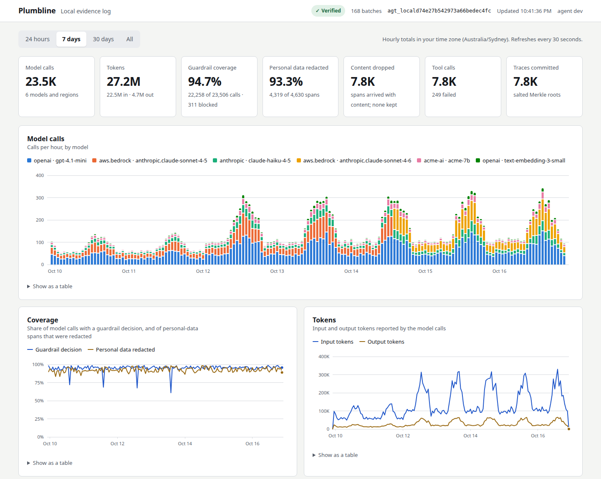
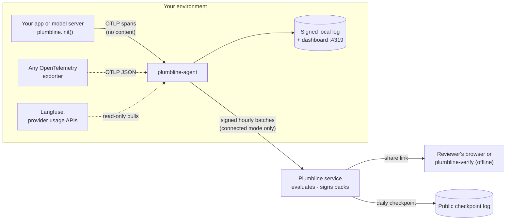

# Plumbline

**Signed, content-free evidence of how your AI system actually runs.**

Add one line to an AI app, or to the serving layer of a model you host, and Plumbline keeps a tamper-evident, hour-by-hour record of every model call: which models and regions served it, how many tokens it used, whether a guardrail decided on it, whether personal data was redacted first, what tools an agent called and who approved them, and when a model or prompt changed. It never reads a prompt or a completion.

Run it entirely on your own machine, with a dashboard and nothing leaving your environment. Or connect it to Plumbline's hosted service (early access) to turn that record into monthly **evidence packs** that a bank, insurer or auditor can verify themselves, offline, without trusting you or us.

[](https://github.com/Lumetrix-Advanced-Technologies/plumbline/actions/workflows/ci.yml)
&nbsp;Apache-2.0 · a Go agent with no runtime dependencies · Python and Node.js SDKs with no dependencies



## Contents

1. [Who it is for: use cases](#who-it-is-for-use-cases)
2. [How it works](#how-it-works)
3. [Quick start: five minutes, no account](#quick-start-five-minutes-no-account)
4. [Install](#install)
5. [Instrument your app](#instrument-your-app)
6. [Run the agent](#run-the-agent)
7. [The dashboard](#the-dashboard)
8. [Reports in the terminal](#reports-in-the-terminal)
9. [Configuration reference](#configuration-reference)
10. [More evidence sources: Langfuse and provider usage](#more-evidence-sources-langfuse-and-provider-usage)
11. [What leaves your machine](#what-leaves-your-machine)
12. [Deploying the agent](#deploying-the-agent)
13. [Signed evidence packs: the hosted service (early access)](#signed-evidence-packs-the-hosted-service-early-access)
14. [Verify a pack](#verify-a-pack)
15. [Security model](#security-model)
16. [CLI reference](#cli-reference)
17. [Troubleshooting](#troubleshooting)
18. [Develop and contribute](#develop-and-contribute)
19. [Security reports and licence](#security-reports-and-licence)

---

## Who it is for: use cases

### You build an AI-powered app or agent

You call OpenAI, Anthropic, Amazon Bedrock or any OpenAI-compatible API, and your customers' security, risk and procurement teams keep asking the same questions.

| You need to show | What Plumbline records |
| --- | --- |
| **Which models and providers you use, and where they run** (vendor-risk questionnaires, data-residency clauses) | Calls and tokens per provider, model and region, every hour. Packs check them against the models and regions you declared. |
| **That guardrails run on every call** | For each model call, whether a guardrail decided on it (allow, block or flag), and how many were blocked. |
| **That personal data is removed before it reaches a model** | How many spans carried personal data, and how many of those were redacted first. |
| **That no prompt or completion text is kept** | Spans that arrive carrying message content are counted and the content dropped; the count is the evidence. |
| **What changed, and when** | Every model change and prompt-version change, with its time: a material-change log for your AI system. |
| **That evaluations are current** | Evaluation runs (suite, model, prompt version, pass rate, time), set against the models and prompt versions that were actually live. |
| **That an agent's actions are under control** | Agent runs, tool calls and tool errors, high-impact tool calls and how many were approved, hand-offs to a person. |
| **That nothing was left out** | A Merkle commitment to every trace in every hour, and token totals that can be reconciled with the provider's own billed usage. |
| **Operational awareness, privately** | A local dashboard of all of the above, hour by hour, without sending anything to a SaaS. |

### You are an AI model vendor or inference provider

You serve your own models (or host others') behind an API. Wrap each inference request in your serving layer with one helper, and you can show your customers which models and regions served their traffic, guardrail and redaction coverage on your side, and model changes over time. They can pass that evidence on to their own reviewers. See [For model vendors and inference providers](#for-model-vendors-and-inference-providers).

### You review AI vendors: bank, insurer, auditor, risk or procurement team

A vendor sends you a share link or a pack file. You check it yourself, in your browser or with an offline command, against the issuer's published keys: no account, no trust in the vendor, no trust in Plumbline. Three independent verifiers (Go, browser, Python) must agree on every [published test vector](spec/vectors/README.md), and you can write a fourth. See [Verify a pack](#verify-a-pack).

### You run security, platform or GRC for an AI product

- Audit exactly what the agent would send before you allow it: `plumbline-agent run --dry-run` prints every batch, decoded, and sends nothing.
- Run it with no network egress at all (local mode).
- Map packs to framework references by ID (each objective lists the references it supports) and, with the hosted service, keep your compliance platform (Vanta) up to date automatically.

---

## How it works



| Part | What it does |
| --- | --- |
| **SDKs** (`plumbline-sdk` for Python and Node.js) | `plumbline.init()` instruments the OpenAI, Anthropic and Bedrock client libraries you already use: one span per model call with provider, model, region, token counts, operation, timing and error status. **They never read message content.** Helpers add the facts no client library knows (prompt version, guardrail decision, redaction, tool approval). |
| **Agent** (`plumbline-agent`) | Runs next to your app. Receives spans on `127.0.0.1:4318`, drops every message attribute at parse time, aggregates per hour, commits every trace into a salted Merkle tree, and signs each hourly batch with its own Ed25519 key. |
| **Local mode** | The agent keeps the signed, chained batches in its data directory and serves a dashboard. Nothing is sent anywhere. |
| **Connected mode** | The agent sends the same signed batches to the Plumbline service, which evaluates ten evidence objectives and issues signed, chained monthly packs. |
| **Verifiers** | `plumbline-verify` (offline command), the verify page (in the browser) and `concierge/verify.py` (an independent Python verifier). |

---

## Quick start: five minutes, no account

**1. Start the agent in local mode.** Pick whichever you already have:

```bash
pip install plumbline-agent && plumbline-agent run --local     # Python 3.8+
npx plumbline-agent run --local                                # Node.js 18+
docker run -d --name plumbline-agent -p 127.0.0.1:4318:4318 -p 127.0.0.1:4319:4319 \
  -v plumbline-agent:/data ghcr.io/lumetrix-advanced-technologies/plumbline-agent:latest run --local
```

It prints its agent ID, where it listens, and the dashboard address:

```
plumbline-agent v0.2.0 in local mode as agt_local73a55408e4b8f1c62de97a60: listening for spans on 127.0.0.1:4318; signed batches are kept in .plumbline-agent/local and never sent.
Dashboard: http://127.0.0.1:4319/
In a terminal: plumbline-agent report
```

**2. Add the SDK to your app.**

```bash
pip install plumbline-sdk        # Python 3.10+
npm install plumbline-sdk        # Node.js 18+
```

```python
import plumbline
plumbline.init()                 # once, at start-up, before your first model call
```

```js
import * as plumbline from 'plumbline-sdk';
plumbline.init();
```

**3. Make a model call, then open http://127.0.0.1:4319.** The first batch appears about a minute after the first call, and every hour after that.

That is all for local mode. To share signed packs with reviewers, see [the hosted service](#signed-evidence-packs-the-hosted-service-early-access).

---

## Install

### The agent

| Method | Command | Notes |
| --- | --- | --- |
| **pip** | `pip install plumbline-agent` | Platform wheels for Linux (glibc and musl) x86_64 and aarch64, macOS 12+ x86_64 and arm64, Windows x64 and arm64. Each holds the release's static binary; nothing is compiled or downloaded at install time. `python -m plumbline_agent` works too. |
| **npm** | `npm install -g plumbline-agent`, or `npx plumbline-agent` | The right platform binary comes as an optional dependency; no install scripts. Don't install with `--omit=optional`. |
| **Docker** | `ghcr.io/lumetrix-advanced-technologies/plumbline-agent:<version>` | A static binary on distroless, non-root, for linux/amd64 and linux/arm64. Data in `/data`. |
| **Binary** | [Releases](https://github.com/Lumetrix-Advanced-Technologies/plumbline/releases) | `plumbline-agent-<os>-<arch>`; use `plumbline-agent-bedrock-*` for Amazon Bedrock usage from CloudWatch. |
| **Source** | `go install github.com/lumetrix-advanced-technologies/plumbline/cmd/agent@latest` | Go 1.26+. Add `-tags bedrock` for the Bedrock usage poller. |

### Check a download

Every release binary, `SHA256SUMS`, the release notes, the wheels, the npm tarballs and the container image carry signed build provenance (SLSA, through GitHub artifact attestations) that ties them to this repository's source and release workflows. The npm packages also carry npm provenance.

```bash
sha256sum --ignore-missing -c SHA256SUMS
gh attestation verify plumbline-agent-linux-amd64 --repo Lumetrix-Advanced-Technologies/plumbline
gh attestation verify oci://ghcr.io/lumetrix-advanced-technologies/plumbline-agent:v0.2.0 --repo Lumetrix-Advanced-Technologies/plumbline
npm audit signatures            # in a project that installed plumbline-agent or plumbline-sdk
```

### The SDKs

```bash
pip install plumbline-sdk        # Python 3.10+, standard library only
npm install plumbline-sdk        # Node.js 18+, built-ins only; ESM and CommonJS; TypeScript types included
```

### The verifier

`plumbline-verify-<os>-<arch>` from [Releases](https://github.com/Lumetrix-Advanced-Technologies/plumbline/releases), or `go install github.com/lumetrix-advanced-technologies/plumbline/cmd/verify@latest`.

---

## Instrument your app

### Python

```python
import plumbline
plumbline.init()
```

`init()` takes optional arguments. It is safe to call more than once, and returns whether the SDK is on.

| Argument | Default | Meaning |
| --- | --- | --- |
| `agent_url` | `PLUMBLINE_AGENT_URL`, else `http://127.0.0.1:4318` | Where the agent listens. |
| `service` | `PLUMBLINE_SERVICE`, else `OTEL_SERVICE_NAME` | The service name on every span. |
| `environment` | `PLUMBLINE_ENVIRONMENT` | The deployment environment, such as `production`. |
| `instrument` | `True` | Instrument the installed client libraries. `False` leaves only the helpers. |
| `stream_usage` | `False` | Ask OpenAI for usage on streamed chat completions (`stream_options.include_usage`) when the app has not set `stream_options`. The stream then ends with one extra chunk that has no `choices`. |

Other functions: `plumbline.flush(timeout=2.0)` sends buffered spans now; `plumbline.shutdown()` flushes and stops (it also runs at exit); `plumbline.is_enabled()`; `plumbline.stats()` returns counters (`spans`, `exported`, `dropped`, `export_errors`, `instrumentation_errors`, `instrumented`). `PLUMBLINE_DISABLED=1` turns the SDK off without a code change. It works across threads, `asyncio` tasks and forked workers (gunicorn, uWSGI).

### Node.js and TypeScript

```js
import * as plumbline from 'plumbline-sdk';          // or: const plumbline = require('plumbline-sdk');
plumbline.init({ service: 'claims-api', environment: 'production' });
```

| Option | Default | Meaning |
| --- | --- | --- |
| `agentUrl` | `PLUMBLINE_AGENT_URL`, else `http://127.0.0.1:4318` | Where the agent listens. |
| `service` | `PLUMBLINE_SERVICE`, else `OTEL_SERVICE_NAME` | The service name on every span. |
| `environment` | `PLUMBLINE_ENVIRONMENT` | The deployment environment. |
| `instrument` | `true` | Instrument the installed client libraries. |
| `streamUsage` | `false` | As `stream_usage` in Python. |

Other functions:

- `await plumbline.flush()`: call it before a serverless handler or a short script returns.
- `await plumbline.shutdown()`, `plumbline.isEnabled()`, `plumbline.stats()`.
- `await plumbline.ready()`: resolves once the ES-module copies of the client libraries are instrumented; await it if a module calls a model straight after `init()`.
- `plumbline.instrument({ openai: OpenAI, anthropic: Anthropic, bedrock: await import('@aws-sdk/client-bedrock-runtime') })`: for bundled apps, or strict package managers, where the SDK cannot find the libraries itself.

### What is instrumented automatically

| Library | Calls |
| --- | --- |
| `openai` (Python and Node.js) | `chat.completions.create` / `parse` / `stream`, `responses.create` / `parse` / `stream`, `embeddings.create`, `completions.create`; sync, async and streaming. Azure OpenAI is reported as `azure.ai.openai`, other OpenAI-compatible endpoints by their host name. |
| `anthropic` / `@anthropic-ai/sdk` | `messages.create` and `messages.stream`, and `beta.messages`. `AnthropicBedrock` and `AnthropicVertex` are reported as `aws.bedrock` and `gcp.vertex_ai`, with their region. |
| `boto3` Bedrock Runtime / `@aws-sdk/client-bedrock-runtime` | `converse`, `converse_stream`, `invoke_model`, `invoke_model_with_response_stream` (in Node.js, the matching `*Command`s through `client.send()`). A Converse call with `guardrailConfig` is a guarded call, blocked when the stop reason is `guardrail_intervened`. |

Per call, the SDK reads the request's model and stream flag, and from the response only the model, the usage block, the stop reason and Bedrock's token-count headers. Input tokens follow what the provider bills (Anthropic: uncached + cache writes + cache reads), so traced tokens can be reconciled with billed usage. Streams are recorded once, when they end. Calls through `invoke_model_with_response_stream` and `with_raw_response` are counted without tokens, because their counts sit only inside bodies the SDK never reads.

### Record what no client library knows

Plumbline's evidence objectives need a few facts only your code knows. In Python, each helper is a context manager (`with` / `async with`) and a decorator. In Node.js, it is a callback scope that returns whatever the callback returns, and follows `await`, timers and callbacks.

| Python | Node.js | Records |
| --- | --- | --- |
| `plumbline.trace()` | `trace(fn)` | Groups everything inside into one trace, for example one web request. |
| `plumbline.prompt(name, version)` | `prompt(name, version, fn)` | The prompt (name and version, never its text) used by calls inside. |
| `plumbline.personal_data(redacted=False)` | `personalData({ redacted }, fn)` | Spans inside handle personal data; `redacted` means it was removed or masked before the model saw it. |
| `plumbline.guardrail(decision=None)` | `guardrail(decision?, fn)` | The guardrail decision for calls inside: `allow`, `block` or `flag`, set later with `g.allow()`, `g.block()`, `g.flag()`. A block with no call inside counts as one blocked call. |
| `plumbline.tool(name, high_impact=False, approved=False)` | `tool(name, { highImpact, approved }, fn)` | A tool call; an exception marks it failed. Set `t.approved = True` once a person or policy approves it. |
| `plumbline.agent_run(name)` | `agentRun(name, fn)` | One agent run; model changes are tracked per agent. |
| `plumbline.escalation()` | `escalation()` | The request was handed to a person. |
| `plumbline.llm_call(provider, model, operation="chat", region=None)` | `llmCall({ provider, model, operation, region }, fn)` | A model call the SDK does not instrument; report its usage with `c.usage(input_tokens, output_tokens)`. |

```python
@app.post("/claims/{claim_id}/triage")
def triage(claim_id: str, req: Request):
    with plumbline.trace(), plumbline.prompt("claims-triage", "14"), plumbline.personal_data(redacted=True):
        with plumbline.guardrail() as g:
            if not input_policy_ok(req):
                g.block()                      # one blocked call; the model was never called
                return refusal()
            r = client.chat.completions.create(model="gpt-4.1-mini", messages=redact(req.messages))
            g.flag() if needs_review(r) else g.allow()
            return r

@plumbline.tool("issue_refund", high_impact=True)
def issue_refund(claim):
    ...
```

```js
app.post('/claims/:id/triage', (req, res) =>
  plumbline.trace(() =>
    plumbline.prompt('claims-triage', '14', () =>
      plumbline.personalData({ redacted: true }, () =>
        plumbline.guardrail(async (g) => {
          if (!inputPolicyOk(req.body)) { g.block(); return res.status(422).end(); }
          const r = await openai.chat.completions.create({ model: 'gpt-4.1-mini', messages: redact(req.body.messages) });
          needsReview(r) ? g.flag() : g.allow();
          res.json(r);
        })))));
```

Calls inside a `guardrail` scope are held until it ends, so a decision made after the call (an output check) still applies. Names and versions are capped at 128 characters.

### For model vendors and inference providers

If you serve models yourself, there is no client library to patch. Wrap each inference request in your serving layer with `llm_call`, naming your own provider and model, and report the tokens you already count:

```python
@app.post("/v1/chat/completions")
def chat(req):
    with plumbline.trace(), plumbline.llm_call("acme-ai", req.model, region="eu-west-1") as c:
        with plumbline.guardrail() as g:
            out = engine.generate(req)
            g.block() if out.filtered else g.allow()
        c.usage(out.prompt_tokens, out.completion_tokens)
        return out
```

```js
app.post('/v1/chat/completions', (req, res) =>
  plumbline.trace(() => plumbline.llmCall({ provider: 'acme-ai', model: req.body.model, region: 'eu-west-1' }, async (c) => {
    const out = await engine.generate(req.body);
    c.usage(out.promptTokens, out.completionTokens);
    res.json(out);
  })));
```

### Already on OpenTelemetry?

Skip the SDK and point an OTLP/HTTP **JSON** exporter at `http://127.0.0.1:4318/v1/traces`. The agent reads the OpenTelemetry GenAI conventions (old and new attribute names) and a few `plumbline.*` attributes, as listed in [`spec/semconv-map.json`](spec/semconv-map.json):

| Fact | Attributes the agent reads |
| --- | --- |
| Provider | `gen_ai.provider.name`, `gen_ai.system` |
| Model | `gen_ai.request.model`, `gen_ai.response.model` |
| Tokens | `gen_ai.usage.input_tokens` or `prompt_tokens`; `gen_ai.usage.output_tokens` or `completion_tokens` |
| Operation | `gen_ai.operation.name`, `llm.request.type` (`chat`, `text_completion`, `generate_content`, `embeddings`); `invoke_agent` and `execute_tool` mark agent runs and tool calls |
| Region | `cloud.region`, `aws.region` |
| Agent | `gen_ai.agent.name` |
| Prompt | `plumbline.prompt.name`, `plumbline.prompt.version` |
| Personal data | `plumbline.data_class` = `personal`; `plumbline.redaction.applied` |
| Guardrail | `plumbline.guardrail.decision` (`allow`, `block`, `flag`) |
| Tools | `plumbline.tool.high_impact`, `plumbline.tool.approved` |
| Escalation | `plumbline.escalation` |

Message attributes (`gen_ai.input.messages`, `gen_ai.output.messages`, `gen_ai.prompt*`, `gen_ai.completion*`, `llm.prompts.*`, `llm.completions.*`) are never read: their presence is counted and their values dropped at parse time. Use either the SDK or your exporter for the same calls, not both, or they are counted twice.

---

## Run the agent

### Modes

| Command | What it does |
| --- | --- |
| `plumbline-agent run --local` | **Local mode.** No account, server or token. Signs batches with its own key, keeps them in `<data-dir>/local`, and serves the dashboard on `127.0.0.1:4319`. Nothing is sent. (`plumbline-agent local` does the same.) |
| `plumbline-agent connect <token>` | **Connected mode, in one command.** Enrols with a one-time token from the Plumbline app (unless the data directory is already enrolled), keeps a salt secret in the data directory, then runs and sends signed batches to `PLUMBLINE_SERVER`. Running it again later just runs. |
| `plumbline-agent enrol --config agent.json` | Enrol only, with the token from `--token` or `PLUMBLINE_ENROL_TOKEN`. |
| `plumbline-agent run --config agent.json` | Run an enrolled agent with a config file (sources, aggregation settings). |
| `plumbline-agent run --config agent.json --dry-run` | Print every batch it would send, with its payload decoded; send, queue and store nothing. Works before enrolment. |
| `plumbline-agent run --config agent.json --dry-run --replay export.jsonl` | Feed an OTLP JSON export through the pipeline, print every window and exit: the fastest way to see what Plumbline would make of traces you already have. |
| `plumbline-agent report` | Verify and summarise the local log in the terminal. |
| `plumbline-agent dashboard --data-dir <dir>` | Serve the dashboard on its own for a data directory (a copied log, or one written elsewhere). |
| `plumbline-agent version` | Print the version. |

A local-mode data directory and an enrolled one never mix: `connect` refuses a local data directory, and local mode refuses an enrolled one. Local batches stay local; connecting starts a new agent with its own data directory.

### Hourly windows

Spans are aggregated into hourly windows (UTC). A window closes `grace_minutes` (default 5) after the hour, so late spans still count; spans later than that go into the next window and are counted as late. After a start, the open hour is also sent once, `first_batch_seconds` (default 60) after the first spans, so a new agent shows up at once. Windows are additive, so the rest of that hour follows when it closes. Each batch names the previous batch's digest and carries the next sequence number, so a lost, edited or replayed batch is detected.

---

## The dashboard

`plumbline-agent run --local` serves it on **http://127.0.0.1:4319**. It reads the same verified log as `report`, so the two can never disagree.

| Panel | Shows |
| --- | --- |
| **Status bar** | ✓ Verified or ✕ Failed (with the first problem), the number of batches, the agent ID, and when it last refreshed. |
| **Totals** | Model calls and models, tokens in and out, guardrail coverage and blocked calls, personal-data redaction, spans whose content was dropped, tool calls and failures, traces committed. |
| **Model calls** | Calls per hour (per day for long ranges), stacked by model, with a legend. The six busiest models keep their colours across ranges; the rest fold into "Other". |
| **Coverage** | Guardrail coverage and personal-data redaction over time, as percentages. |
| **Tokens** | Input and output tokens over time. |
| **Models and regions** | Every provider, model and region in the range, with calls, share and tokens. |
| **Timeline** | Model and prompt changes, anomaly hours (unusual error or guardrail-block rates) and evaluation runs. |
| **Evidence chain** | The newest batches, with sequence numbers, hours, calls, traces and full digests. |

Choose a range with the buttons (24 hours, 7 days, 30 days, All); a link can pick one with `#range=7d`. Hover a chart, or focus it and use the arrow keys, for an hour's figures; every chart also has a table view. It refreshes every 30 seconds, follows your system's light or dark theme, and works at phone width.

The agent serves it on loopback only. It answers only GET requests, refuses any request whose Host is not a local name (so a web page cannot read it through DNS rebinding), loads nothing from anywhere else, and stores nothing but your chosen range. Move it with `dashboard_listen` or `PLUMBLINE_DASHBOARD_LISTEN`, or turn it off with `off`. To look at a log somewhere else: `plumbline-agent dashboard --data-dir /path/to/copy --listen 127.0.0.1:4320`.

---

## Reports in the terminal

```bash
plumbline-agent report                                  # the whole log
plumbline-agent report --since 2026-10-01 --until 2026-10-31
plumbline-agent report --json > october.json            # the same, as JSON
plumbline-agent report --data-dir /path/to/copy         # a copied log
docker exec plumbline-agent /plumbline-agent report     # inside the container
```

```
Plumbline local evidence log, agent agt_localf444634e45d1d9b9d0208705
  Verified: 2 batches, signed by this agent's key and chained from batch 1 to 2.
  Latest batch digest: sha256:00a34bc8802ae6135dbd64864373a0b3e391beb4b43e84199eb5786f631a6258
  Windows: 2026-09-01T00:00:00Z to 2026-09-01T02:00:00Z (UTC)

Model calls
  provider     model                        region          calls  input tokens  output tokens
  aws.bedrock  anthropic.claude-sonnet-4-5  ap-southeast-2  200    259900        60594
  openai       gpt-4.1-mini                 us-east-1       80     7200          320
  aws.bedrock  anthropic.claude-sonnet-4-6  ap-southeast-2  40     56780         12121

Guardrails      240 of 320 model calls had a guardrail decision (75.0%); 10 blocked
Personal data   54 of 60 spans with personal data were redacted (90.0%)
Content         240 spans arrived with message content; the agent dropped it
Agents          240 runs, 240 tool calls (8 failed), 24 high-impact calls (12 approved), 1 escalations
Traces          240 committed (salted Merkle roots; disclose one later from this data directory)
Change          2026-09-01T01:15:16Z: prompt 13 -> 14
Change          2026-09-01T01:40:13Z: model anthropic.claude-sonnet-4-5 -> anthropic.claude-sonnet-4-6
Anomaly         2026-09-01T00:00:00Z to 2026-09-01T01:00:00Z: guardrail_rate
```

The report checks every batch's signature against `agent.pub`, that the sequence runs from 1 without gaps, that each batch names the previous batch's digest, and that no batch is missing from the end. If any check fails it says where, and exits **1**, so it can gate a CI job or a cron alert. `--since` and `--until` limit the figures, never the checks.

What a local log proves: it has not changed since it was written, relative to `agent.pub`. Keep a copy of `agent.pub` somewhere else, or give it to a reviewer up front. For evidence signed by an independent issuer, see [the hosted service](#signed-evidence-packs-the-hosted-service-early-access).

---

## Configuration reference

`run --local` and `connect` need no file. For anything more, write a JSON file and pass `--config agent.json`. A complete file with every source off ([`agent.example.json`](agent.example.json)):

```json
{
  "server": "https://<server>",
  "data_dir": "./.plumbline-agent",
  "otlp_listen": "127.0.0.1:4318",
  "dashboard_listen": "127.0.0.1:4319",
  "langfuse": { "enabled": false, "base_url": "https://cloud.langfuse.com",
                "public_key_env": "LANGFUSE_PUBLIC_KEY", "secret_key_env": "LANGFUSE_SECRET_KEY", "eval_scores": [] },
  "usage": {
    "openai":    { "enabled": false, "admin_key_env": "OPENAI_ADMIN_KEY", "project_ids": [] },
    "anthropic": { "enabled": false, "admin_key_env": "ANTHROPIC_ADMIN_KEY", "workspace_ids": [] },
    "bedrock":   { "enabled": false, "region": "ap-southeast-2" }
  },
  "salt_secret_env": "PLUMBLINE_SALT_SECRET",
  "salt_secret_file": "",
  "aggregation": { "grace_minutes": 5, "first_batch_seconds": 60,
                   "anomaly": { "min_calls": 20, "error_rate": 0.05, "guardrail_block_rate": 0.03 } }
}
```

| Key | Default | Meaning |
| --- | --- | --- |
| `server` | none | The Plumbline server, for connected mode. `https`, or `http` for localhost only. |
| `data_dir` | `./.plumbline-agent` (`/data` in the container) | The key, queue, local log, commitment leaves and salt. |
| `otlp_listen` | `127.0.0.1:4318` | The span receiver. A non-loopback address needs `otlp_allow_remote`. |
| `otlp_allow_remote` | `false` | Allow listening beyond loopback. The receiver has no authentication, so do this only on a network you control. |
| `dashboard_listen` | `127.0.0.1:4319` | The local-mode dashboard; `off` turns it off. Same loopback rule. |
| `langfuse.*` | off | The [Langfuse puller](#langfuse). |
| `usage.*` | off | The [provider usage pollers](#provider-usage). |
| `salt_secret_env` / `salt_secret_file` | `PLUMBLINE_SALT_SECRET` | The secret that salts trace commitments. With `connect` or `run --local` and none set, a random one is kept in `<data-dir>/salt.secret`. |
| `aggregation.grace_minutes` | `5` | How long after the hour a window stays open (1 to 55). |
| `aggregation.first_batch_seconds` | `60` | When the open hour is sent once after a start (0 to 3600). |
| `aggregation.anomaly.*` | `20`, `0.05`, `0.03` | An hour with at least `min_calls` calls and an error rate or guardrail-block rate above these is an anomaly window. |

Secrets are never written in the file. Each `*_env` key names the environment variable that holds a secret, and the salt can come from a file with mode `0600`.

### Environment variables

| Variable | Overrides | Notes |
| --- | --- | --- |
| `PLUMBLINE_SERVER` | `server` | |
| `PLUMBLINE_DATA_DIR` | `data_dir` | |
| `PLUMBLINE_OTLP_LISTEN` | `otlp_listen` | |
| `PLUMBLINE_DASHBOARD_LISTEN` | `dashboard_listen` | |
| `PLUMBLINE_OTLP_ALLOW_REMOTE=1` | `otlp_allow_remote` | Set in the container image, whose documented commands publish ports on the host's loopback only. |
| `PLUMBLINE_ENROL_TOKEN` | | The token for `enrol` and `connect` when it is not given on the command line. |
| `PLUMBLINE_SALT_SECRET` | | The default salt variable. |
| SDK: `PLUMBLINE_AGENT_URL`, `PLUMBLINE_SERVICE`, `PLUMBLINE_ENVIRONMENT`, `PLUMBLINE_DISABLED` | | See [Instrument your app](#instrument-your-app). |

---

## More evidence sources: Langfuse and provider usage

Each source is read-only and off until you turn it on. Content is dropped the same way as for spans.

### Langfuse

```json
"langfuse": { "enabled": true, "base_url": "https://cloud.langfuse.com",
              "public_key_env": "LANGFUSE_PUBLIC_KEY", "secret_key_env": "LANGFUSE_SECRET_KEY",
              "eval_scores": [ { "name": "faithfulness", "suite": "rag-eval", "pass_at_least": 0.8 } ] }
```

The agent pulls traces from your Langfuse project with its keys. `eval_scores` turns Langfuse scores into evaluation runs: scores named `name` are recorded as runs of `suite`, passing when the score is at least `pass_at_least`.

### Provider usage

```json
"usage": {
  "openai":    { "enabled": true, "admin_key_env": "OPENAI_ADMIN_KEY", "project_ids": ["proj_..."] },
  "anthropic": { "enabled": true, "admin_key_env": "ANTHROPIC_ADMIN_KEY", "workspace_ids": ["wrkspc_..."] },
  "bedrock":   { "enabled": true, "region": "ap-southeast-2" }
}
```

The agent polls the providers' usage APIs with an admin key (limit it to this system's projects or workspaces) and puts each hour's billed tokens in the batch, so traced tokens can be compared with billed ones: that is the trace-coverage objective. Bedrock usage comes from CloudWatch in `region`, with the default AWS credential chain, and needs a `plumbline-agent-bedrock-*` binary (or `-tags bedrock`).

---

## What leaves your machine

**In local mode, nothing.** In connected mode, one signed batch per hour, defined by [`spec/batch.schema.json`](spec/batch.schema.json). Here is a real batch, trimmed (`plumbline-agent run --dry-run` shows yours):

```json
{
  "schema": "plumbline-batch/v0.2",
  "agent_id": "agt_dryrun0000000000",
  "seq": 1,
  "prev": null,
  "window": { "start": "2026-09-01T00:00:00Z", "end": "2026-09-01T01:00:00Z" },
  "metrics": {
    "tokens": [ { "provider": "aws.bedrock", "model": "anthropic.claude-sonnet-4-5", "region": "ap-southeast-2",
                  "calls": 120, "input_tokens": 151140, "output_tokens": 36357 } ],
    "pii": { "pii_spans": 30, "pii_spans_redacted": 27 },
    "content_present_spans": 120,
    "guardrails": { "llm_calls": 160, "guarded_calls": 120, "blocked": 5 },
    "agent": { "runs": 120, "tool_calls": 120, "tool_errors": 4, "high_impact_calls": 12, "high_impact_approved": 6, "escalations": 1 }
  },
  "commit": { "root": "0d98141acd04af7a42b105bc3ea41d751f0e8227e6baa89bcf716dc946dc701a", "leaves": 120 }
}
```

A full batch also lists evaluation runs, model and prompt changes, anomaly windows, which models and prompt versions were live, late spans and provider usage. It **never** contains:

- prompts, completions, messages or any span content;
- tool arguments, return values or exception messages;
- end-user identifiers, IP addresses or request bodies;
- raw trace IDs.

Each trace becomes a leaf `sha256(0x00 ‖ salt ‖ trace_id)`, where the salt is derived from a secret that stays with you. The commitment reveals nothing, yet a single trace can later be disclosed and proved to be in it.

### The data directory

| File | What it is |
| --- | --- |
| `agent.key` (0600) | The agent's Ed25519 private key. It signs every batch; losing it means a new agent. |
| `agent.json` | The agent ID (and the server, when enrolled). |
| `agent.pub` | Local mode: the public key, to verify the log without the private key. |
| `local/` | Local mode: the signed, chained batches, never sent. |
| `queue/` | Connected mode: batches the server has not accepted yet, fsynced before they are acknowledged and retried with backoff of up to 15 minutes. |
| `leaves/` | Each window's commitment leaves, for disclosing a trace later. |
| `salt.secret` (0600) | The salt secret, when the agent made one. |

Keep and back up the data directory. In the container it is the `plumbline-agent` volume.

---

## Deploying the agent

### Next to the app on one host

Run the agent as a service (systemd, launchd, or a container with `--restart unless-stopped`) and leave the defaults: the SDK finds it on `127.0.0.1:4318`.

### Docker Compose

```yaml
services:
  app:
    build: .
    environment:
      PLUMBLINE_AGENT_URL: http://plumbline-agent:4318
      PLUMBLINE_SERVICE: claims-api
      PLUMBLINE_ENVIRONMENT: production
  plumbline-agent:
    image: ghcr.io/lumetrix-advanced-technologies/plumbline-agent:v0.2.0
    command: ["run", "--local"]                 # or ["connect", "<token>"], with PLUMBLINE_SERVER set
    ports: ["127.0.0.1:4319:4319"]              # the dashboard, on the host's loopback only
    volumes: ["plumbline-agent:/data"]
volumes:
  plumbline-agent: {}
```

### Kubernetes

Run the agent as a sidecar in the app's pod, so spans never leave the pod, and keep the data directory on a persistent volume.

```yaml
containers:
  - name: app
    env:
      - { name: PLUMBLINE_AGENT_URL, value: "http://127.0.0.1:4318" }
  - name: plumbline-agent
    image: ghcr.io/lumetrix-advanced-technologies/plumbline-agent:v0.2.0
    args: ["run", "--local"]
    volumeMounts: [{ name: plumbline-data, mountPath: /data }]
```

`kubectl port-forward pod/<pod> 4319` opens the dashboard. If one agent serves several pods, restrict who can reach port 4318 with a NetworkPolicy: the receiver has no authentication.

### Serverless and short scripts

Call `plumbline.flush()` (in Node.js, `await plumbline.flush()`) before the handler returns, and run the agent where the function can reach it, set with `PLUMBLINE_AGENT_URL`.

---

## Signed evidence packs: the hosted service (early access)

The local log is signed by your own key. Reviewers usually need evidence signed by someone other than the vendor, evaluated against stated objectives. That is what the hosted Plumbline service adds.

### What you get

**Ten evidence objectives**, evaluated for each AI system over each period:

| ID | Objective | Passes when |
| --- | --- | --- |
| EO-LOG-01 | Trace coverage | Traced tokens are at least 98% of the provider's billed tokens. |
| EO-LIN-01 | Model and provider lineage | Every model seen was declared. |
| EO-CHG-01 | Material-change log | No model or prompt change is missing from the change register. |
| EO-PII-01 | PII redaction coverage | Every span with personal data was redacted. |
| EO-CNT-01 | Content minimisation | No span reached the agent carrying message content. |
| EO-GRD-01 | Guardrail coverage | At least 99.5% of model calls had a guardrail decision. |
| EO-EVAL-01 | Eval freshness | Every live model and prompt version passed an evaluation (pass rate at least 0.9) in the last 7 days. |
| EO-INC-01 | Incident register | Every anomaly hour was acknowledged in the incident register. |
| EO-AGT-01 | Agent action safety | Tool calls fail at most 1% of the time. |
| EO-RES-01 | Inference residency | Every region seen was declared. |

Results near a threshold are marked *attention* rather than pass or fail. Each objective lists the framework references it supports, by ID (for example ISO/IEC 42001 controls): see [`spec/objectives.json`](spec/objectives.json) and [`spec/framework-refs.json`](spec/framework-refs.json).

Besides the objectives:

- **Monthly packs.** An in-toto statement in a DSSE envelope over canonical JSON (RFC 8785), signed with an ECDSA P-256 key held in AWS KMS, chained to the previous pack by digest, with a Merkle commitment to the period's traces.
- **Share links** for reviewers, which expire and can be revoked, with view counts.
- **A public daily checkpoint** of every pack digest issued that day, signed and chained, so a pack cannot be backdated quietly.
- **Vanta:** an hourly sync of each objective's status with a verify link, and the packs as documents.

### The workflow, step by step

1. [Request early access](https://github.com/Lumetrix-Advanced-Technologies/plumbline/issues/new?template=early-access.yml), and pick what fits: hosted packs, design partner, evidence for models you serve, or reviewer.
2. In the Plumbline app, create your organisation and an AI system, and declare its models, regions and timezone.
3. Create an enrolment token on the system's *Setup and sources* page. The page shows the exact command.
4. Run the agent with it: `PLUMBLINE_SERVER=https://<server> plumbline-agent connect <token>`, or the `docker run` line the page shows. Keep the SDK line in your app as before.
5. Record changes, incidents and evaluation runs in the system's registers (by form or CSV upload), so the change and incident objectives have something to compare with.
6. Issue a pack for a period (by default, the previous calendar month).
7. Create a share link for a reviewer (for one pack, or always the latest) and send it.
8. The reviewer opens it, and the verify page checks the pack in their browser. Or they download it and run `plumbline-verify`.
9. Optionally, connect Vanta in Settings.

---

## Verify a pack

### In the browser

Open a share link: the verify page fetches the pack and the issuer's keys, and checks everything in your browser with Web Crypto. Or open the verify page with no link, choose the issuer's JWKS file and one or more pack files, and it checks them offline, with no network at all. It shows a pack's contents only after its signature verifies.

### Offline, with plumbline-verify

```bash
plumbline-verify --jwks issuer-jwks.json pack.dsse.json
plumbline-verify --jwks https://<issuer>/.well-known/jwks.json 2026-09.dsse.json 2026-10.dsse.json   # oldest first: also checks the chain
plumbline-verify --json --jwks issuer-jwks.json pack.dsse.json                                      # a machine-readable report
```

```
spec/vectors/pass/KST-CTA-0002.dsse.json
  pack ................. KST-CTA-0002 (seq 2)
  digest ............... sha256:91ceb4233b19d3164c6a58292166c052cae2a5cf1cfa680b55f4ad5f6bb9c7c8
  signature ............ valid (key test-p256-2026-10)
  subject digest ....... matches the pack contents
  chain link ........... links to the previous pack
  disclosed trace ...... included in the commitment
  result ............... VERIFIED
RESULT: VERIFIED
```

It checks the issuer's signature (against a key that was valid when the pack was issued and has not been revoked), that the subject digest matches the contents, the link to the previous pack, and any disclosed trace's Merkle proof. Exit status: **0** all verified, **1** a check failed, **2** a usage or input error.

**Prove a pack is in a daily checkpoint:**

```bash
plumbline-verify checkpoint --jwks issuer-jwks.json --prev 2026-10-15.json 2026-10-16.json pack.dsse.json
```

This checks the checkpoint's signature, its Merkle root and its link to the previous day, and that each pack given is in it.

### In Python

```bash
pip install cryptography
python3 concierge/verify.py issuer-jwks.json pack.dsse.json
```

### Write your own verifier

[`spec/vectors/README.md`](spec/vectors/README.md) gives the formats and the four manifests every verifier must match: pass and fail packs, extra cases, key-validity cases and canonical-JSON cases. If your verifier disagrees with ours on any case, one of us has a bug: please [report it privately](SECURITY.md).

---

## Security model

- **No content leaves the customer.** The SDKs never read message content, the agent drops message attributes at parse time, and batches carry only counts, short names and commitments. `--dry-run` shows exactly what would be sent.
- **One destination.** In connected mode the agent sends batches only to the server you configure; the only other outbound calls are the read-only Langfuse and provider usage APIs you turn on. In local mode it sends nothing.
- **Keys stay where they are made.** The agent's Ed25519 key is generated on your machine (mode 0600); the issuer's signing key never leaves AWS KMS.
- **Tamper-evident at every step.** Batches are signed and chained. Packs are signed, chained and listed in a public daily checkpoint. Keys are published with validity dates and a revocation list.
- **The receiver has no authentication**, so it listens on loopback unless you allow otherwise, on a network you control. The dashboard is loopback-only and read-only, and refuses non-local Host names.
- **What we do not claim.** A pack shows what your telemetry shows: calls that bypass the agent are not in it (trace coverage measures that gap against billed usage). A signature proves who signed and that nothing changed since; it does not prove the telemetry was complete or truthful.

The full statement is on the [security page](web/security/index.html).

---

## CLI reference

### plumbline-agent

```
plumbline-agent run --local [--config <agent.json>]
plumbline-agent report [--config <agent.json>] [--data-dir <dir>] [--since YYYY-MM-DD] [--until YYYY-MM-DD] [--json]
plumbline-agent dashboard [--config <agent.json>] [--data-dir <dir>] [--listen <host:port>]
plumbline-agent connect [--config <agent.json>] <token>
plumbline-agent enrol --config <agent.json> [--token <token>]
plumbline-agent [run] --config <agent.json> [--dry-run] [--replay <export.jsonl>]
plumbline-agent version
```

| Flag | Commands | Meaning |
| --- | --- | --- |
| `--config <file>` | all | The agent config file (optional for `run --local`, `connect`, `report` and `dashboard`). |
| `--local` | `run` | Local mode: no server, signed batches kept in the data directory, dashboard served. |
| `--dry-run` | `run` | Print every batch with its payload decoded; send, queue and store nothing. |
| `--replay <file>` | `run` | Feed an OTLP JSON export (one request per line) through the pipeline, then exit. |
| `--token <token>` | `enrol` | The one-time enrolment token (default `PLUMBLINE_ENROL_TOKEN`). |
| `--data-dir <dir>` | `report`, `dashboard` | Read this data directory instead of the configured one. |
| `--since`, `--until` | `report` | The first and last day to sum (UTC dates). Verification always covers the whole log. |
| `--json` | `report` | Print the summary as JSON. |
| `--listen <host:port>` | `dashboard` | Where to serve it (default `dashboard_listen`, else `127.0.0.1:4319`). |

Exit status: **0** ok, **1** a runtime error (or, for `report`, a verification failure), **2** a usage or configuration error.

### plumbline-verify

```
plumbline-verify --jwks <file|https-url> [--json] pack1.json [pack2.json ...]
plumbline-verify checkpoint --jwks <file|https-url> [--prev yesterday.json] checkpoint.json [pack.json ...]
plumbline-verify --version
```

Exit status: **0** all verified, **1** a check failed, **2** a usage or input error.

---

## Troubleshooting

| Symptom | What to check |
| --- | --- |
| The dashboard says "Waiting for your first model call" | Is the app calling `plumbline.init()` before its first model call, and can it reach `PLUMBLINE_AGENT_URL`? `plumbline.stats()` shows `exported` and `export_errors`. The first batch comes about a minute after the first span. |
| `stats()` shows `spans: 0` | The client library is not instrumented: check `stats()["instrumented"]`. In Node.js ES modules, `await plumbline.ready()`; in bundled apps, use `plumbline.instrument({...})`. Or wrap the call in `llm_call`. |
| Counts are doubled | The SDK and another OpenTelemetry exporter both send the same calls. Use one. |
| Streamed OpenAI calls have no tokens | Turn on `stream_usage` (`streamUsage`), or set `stream_options` yourself. |
| `npx plumbline-agent` says "no binary for …" | Your platform is not linux, darwin or win32 on x64 or arm64, or optional dependencies were omitted (`--omit=optional`). Download a binary from Releases instead. |
| "otlp_listen … is not a loopback address" | Set `otlp_allow_remote` (or `PLUMBLINE_OTLP_ALLOW_REMOTE=1`) and restrict the port at the network. |
| The dashboard says it "answers only on localhost" | Open it as `http://127.0.0.1:4319` or `http://localhost:4319` (or a `*.localhost` name). |
| Port 4319 is in use | `PLUMBLINE_DASHBOARD_LISTEN=127.0.0.1:4329`, or `off`. |
| `report` says FAILED | The message names the first bad batch: edited (signature), missing, or out of order. The figures cover only the batches before it. Restore the data directory from a backup. |
| `connect` refuses the data directory | It holds a local-mode agent. Use a new data directory (or volume) for connected mode. |
| No agent appears in the Plumbline app | Check the agent's log for an enrolment error. A used or expired token needs a new one. |

---

## Develop and contribute

```bash
git clone https://github.com/Lumetrix-Advanced-Technologies/plumbline.git && cd plumbline
make check          # gofmt, vet, staticcheck, govulncheck, race tests, every verifier on every vector, SDK and packaging tests
```

The tests need Go 1.26+, Node.js 22+ and Python 3.10+ with `cryptography`. The Go code uses only the standard library, plus the AWS SDK in the `bedrock` build.

| Target | What it does |
| --- | --- |
| `make check` | All of the test targets below. |
| `make test` | `go test -race ./...`, plus the `bedrock` build's usage poller. |
| `make vectors` | All three verifiers on every test vector. |
| `make sdk-test` | Both SDKs' tests. |
| `make package-test` | The pip and npm packaging tests. |
| `make agent-dry` | A dry run over the sample OTLP export. |
| `make dashboard-demo` | The dashboard on a week of synthetic, signed data (`tools/demolog`). |
| `make release-binaries [GOOS=… GOARCH=…] VERSION=…` | Static binaries for every platform, or for one. |
| `make packages VERSION=…` | The wheels and npm packages, from those binaries. |
| `make agent-image VERSION=…` | The container image. |

| Path | What it is |
| --- | --- |
| `cmd/agent`, `cmd/verify` | The two programs. |
| `internal/` | `otlp` (parsing and content dropping), `aggregate` (hourly windows), `commitment` and `merkle`, `batch` and `batchsign`, `queue`, `enrol`, `langfuse`, `usage`, `agent`, `localreport`, `dashboard`; and the trust core, `jcs`, `dsse`, `pack` and `checkpoint`. |
| `sdk/python`, `sdk/js` | The SDKs, each with its own README. |
| `web/verify` | The static verify page; `web/security` and `web/docs` are the site's other pages. |
| `spec/` | Schemas, objectives, framework references, the attribute map and the test vectors. |
| `concierge/` | The reference Python verifier, and the ingest it is checked against. |
| `packaging/` | The pip and npm package builders. |
| `examples/` | Sample Python and Node.js apps with the one-line integration. |

Every change keeps two rules: **no content leaves the customer** (no code path in the agent or the SDKs may send prompt or completion text, span content or raw trace IDs), and **the verifiers agree** (test vectors are added, never changed). The SDKs must never break or block the host app.

**Releases.** Pushing a tag `vX.Y.Z` runs the release workflow: checks, six-platform builds, checksums, attestations, a draft release and the container image. Publishing the release runs `packages.yml`, which builds the pip and npm packages from the release's own attested binaries. The SDKs release on `sdk-vX.Y.Z`. See [CHANGELOG.md](CHANGELOG.md).

---

## Security reports and licence

Report vulnerabilities privately, through GitHub's private vulnerability reporting (the Security tab), not in a public issue: see [SECURITY.md](SECURITY.md). Apache License 2.0: see [LICENSE](LICENSE) and [NOTICE](NOTICE).
